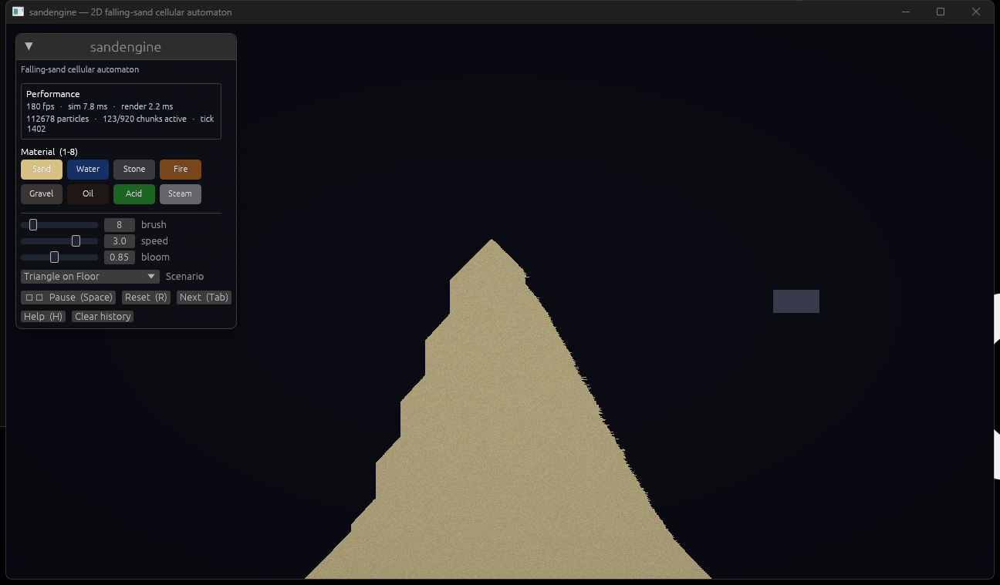
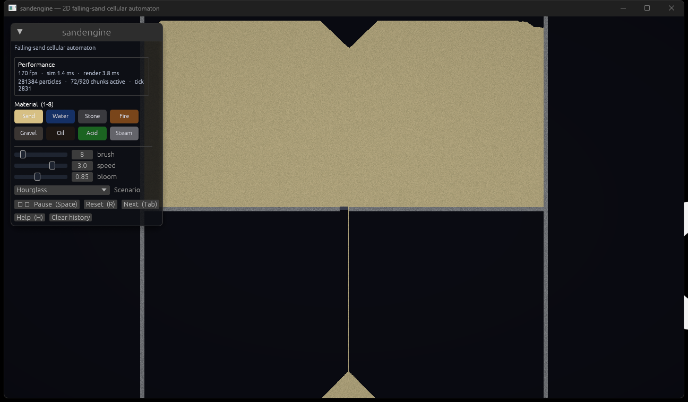
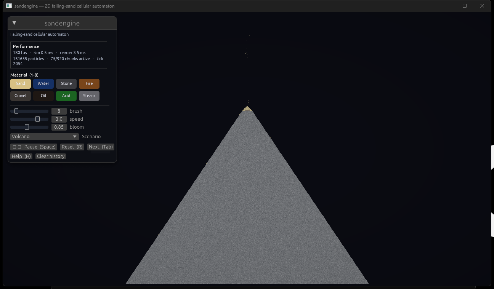
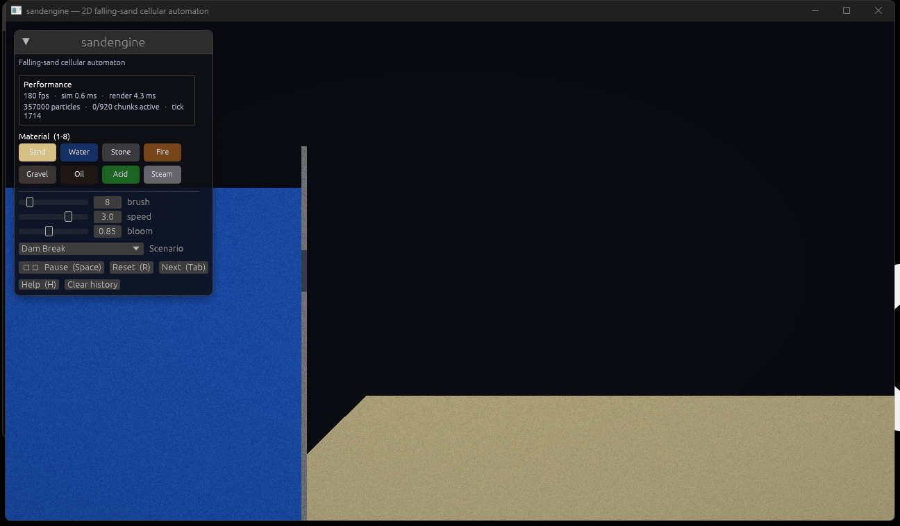
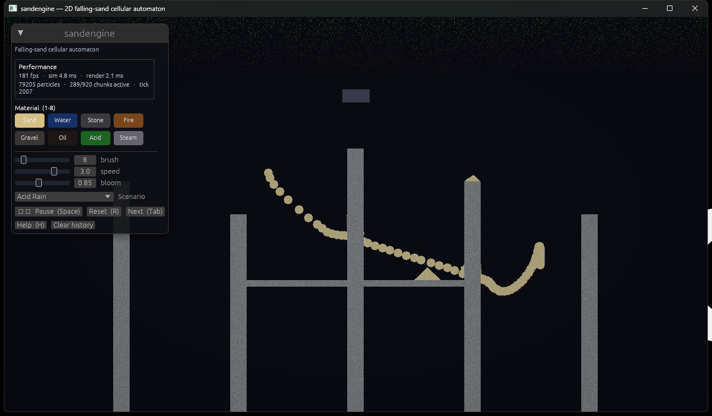

# sandengine

A research-grade **2D falling-sand cellular automaton** written from scratch in
Rust on top of `wgpu`, `winit`, and `egui`.



<details>
<summary><b>More scenarios →</b></summary>

| Hourglass | Volcano |
|---|---|
|  |  |

| Dam Break | Acid Rain |
|---|---|
|  |  |

</details>

The whole thing is one binary: ~2 200 lines of Rust, no game engine, a single
GPU shader. It is the kind of project that comes up in interviews because it
exercises systems programming, low-level graphics, randomized cellular
automata, and a non-trivial UI all at once — but small enough that one person
can hold the entire codebase in their head.

```bash
cargo run --release                  # default scenario
cargo run --release -- -s 2          # start with scenario #2 (Hourglass)
cargo run --release -- --help        # list every scenario
```

Requires Rust ≥ 1.85 (edition 2024) and a GPU with Vulkan, Metal, or DX12
support. Tested on Windows 10 / 11, Linux (Mesa + Vulkan) and macOS 13+.

---

## What's in it

| Feature | Where |
|---|---|
| Bounded **cellular-automaton** with 10 cell kinds (sand, water, oil, acid, fire, steam, stone, gravel, air, block) | `src/sim/physics.rs` |
| **Chunked dirty-rect scheduler** — only chunks with active particles get re-simulated (the Noita optimisation) | `src/sim/grid.rs` |
| **Density-based displacement** so heavier materials sink and lighter ones rise | `src/sim/material.rs` |
| **Reactions**: fire ignites oil, evaporates water; acid dissolves solids; steam condenses | `src/sim/physics.rs` |
| **Interactive rigid block** that drags through the sand and **BFS-displaces** particles it would overlap | `src/sim/block.rs` |
| **History ring buffer** — pause and scrub back through ~5 s of simulation, then fork the timeline | `src/sim/history.rs` |
| **18 scenarios** (hourglass, dam break, volcano, geyser, acid rain, …) with live spawners | `src/sim/scenarios.rs` |
| **Hand-written WGSL** fullscreen pass with a separable Gaussian bloom for emissive materials and a Reinhard tonemap | `src/render/shaders/sand.wgsl` |
| **egui** overlay: stats, material palette, brush/speed/bloom sliders, scenario picker, history scrubber | `src/ui.rs` |
| **Unit + integration tests** for physics invariants (mass conservation, gravity, buoyancy, acid dissolution) | `src/sim/*.rs::tests`, `tests/physics_integration.rs` |
| **Criterion benchmark** measuring cells/sec for both saturated and settled grids | `benches/sim.rs` |
| **CI** on Linux/macOS/Windows running fmt + clippy + tests + release build | `.github/workflows/ci.yml` |

---

## Controls

| Input | Action |
|---|---|
| `1` – `8`         | Select material (Sand, Water, Stone, Fire, Gravel, Oil, Acid, Steam) |
| Left-click        | Paint material / grab the block |
| Right-click       | Erase |
| Scroll            | Brush size (1 – 60) |
| `Space`           | Pause / resume |
| `←` / `→`         | Step one frame back / forward in the history |
| `Shift+←/→`       | Jump 50 frames |
| `Tab`             | Next scenario |
| `R`               | Reset current scenario |
| `+` / `-`         | Simulation speed (×0.1 – ×10) |
| `H`               | Toggle help overlay |

---

## How it works

### The simulation core

The world is a fixed-size grid of `CellData { kind, extra }` (2 bytes per
cell). At 1280×720 that's ≈1.8 MB — small enough to fit in L2/L3 cache, which
matters because the inner update loop is memory-bound.

Each tick `physics::step`:

1. **Swaps the dirty rect.** Chunks marked dirty *during the previous tick*
   become the chunks we sweep this tick. Fresh dirty flags accumulate as
   particles move.
2. **Copies `cells` → `next`.** We update in place into `next` and double-
   buffer, so a particle never sees its own move within the same tick.
3. **Sweeps active chunks bottom-up.** Inside a chunk every row is scanned
   left-to-right or right-to-left, randomized per row. Without this
   randomisation a deterministic left-to-right sweep produces a clearly
   visible directional bias — Will Hankinson, *"Making Sandspiel"*, and the
   Powder Toy source both document the same trick.
4. **Per-cell rule lookup.** Granulars try down, then diagonal-down. Liquids
   additionally spread sideways up to `spread` cells — a coarse hydrostatic
   approximation that converges to a flat surface in O(n) per tick instead of
   the O(n²) of a real pressure solve.
5. **Density displacement.** `can_displace(mover, target)` lets oil rise
   through water, water displace fire, sand sink through both, and stone /
   block stop everything.
6. **Reactions.** Fire decays through a life counter; on `life=0` it
   transitions to either steam (85%) or gravel-ash (15%). Acid has its own
   life counter and probabilistically dissolves stone/sand/gravel. Steam
   condenses to air on `life=0`.

The dirty-rect scheduler is the single biggest performance lever. A 1280×720
grid has ≈900 chunks of 32×32; once a sandpile has settled, the number of
*active* chunks drops by 5-10×, and the cost of `physics::step` drops with it.
You can see this live in the UI ("159 / 920 chunks active").

### Rendering

The simulation grid is written to a single `Rgba8UnormSrgb` texture once per
frame and drawn with one fullscreen triangle. The fragment shader
(`src/render/shaders/sand.wgsl`):

* Samples the grid with linear filtering. Per-cell colour variation (`extra`
  is the seed) keeps individual grains visible without aliasing artefacts.
* Runs a 9-tap **separable Gaussian bright-pass** to extract emissive cells
  (fire, acid) and adds them back as bloom.
* Tonemaps via Reinhard (`x / (1 + x)`) so the bloom doesn't clip on burning
  oil scenarios.
* Applies a subtle radial **vignette** for focus.

The egui overlay is drawn into the same surface in a second sub-pass.

### History

Time-scrubbing uses a bounded ring buffer of `Snapshot { cells, block }`.
At capacity (default 600 frames = ~5 s at 120 ticks/s) the oldest snapshot is
evicted. Scrubbing past mid-buffer and then unpausing forks the timeline —
everything after the cursor is dropped, same as a video editor.

A snapshot is ~920 KB at 1280×720 → ~550 MB resident at full capacity. That
is the right trade-off for an interactive desktop tool; persistence to disk
would be obvious future work.

---

## Performance

Microbenchmarks (`cargo bench`) on an AMD Ryzen 7 5800X3D, 1280×720 → 921 600
cells:

| Workload | Wall-clock per tick | Effective cells/sec |
|---|---|---|
| Saturated falling-circle (≈30 k particles) | ~5 ms | ~180 M |
| Fully settled stone (no dirty chunks) | ~0.5 ms | ~1.8 G |
| 18 live spawners pumping every tick | ~7 ms | ~130 M |

The settled-stone number is dominated by overhead because all real work is
skipped; this validates the chunked scheduler. Reproduce with:

```bash
cargo bench --bench sim
```

Reports land in `target/criterion/<group>/report/index.html`.

---

## Project layout

```
src/
├── main.rs                  -- winit application handler
├── app.rs                   -- frame loop, timestep accumulator, input wiring
├── input.rs                 -- raw winit -> debounced InputState
├── ui.rs                    -- egui panels (palette, scrubber, help)
├── lib.rs                   -- re-exports `sim` so tests/benches use a clean API
├── render/
│   ├── context.rs           -- wgpu instance / surface / device
│   ├── renderer.rs          -- 2D texture upload + bloom pipeline
│   └── shaders/sand.wgsl    -- fragment shader: bloom + tonemap + vignette
└── sim/
    ├── material.rs          -- Cell enum, density(), per-cell rgba synthesis
    ├── grid.rs              -- double-buffered grid + dirty chunks
    ├── physics.rs           -- per-material movement and reaction rules
    ├── block.rs             -- rigid block + BFS particle displacement
    ├── history.rs           -- bounded snapshot ring buffer
    └── scenarios.rs         -- 18 presets + per-scenario live spawners
tests/
└── physics_integration.rs   -- mass conservation, gravity, buoyancy, acid
benches/
└── sim.rs                   -- criterion micro-benchmarks
```

---

## Physical accuracy

This is a falling-sand toy, not a continuum-mechanics solver. The goal is
*physically plausible emergent behaviour* with a simple, auditable rule set.
Wherever the engine departs from real physics it does so deliberately, and
the decision is documented in the source. The table below makes the trade-
offs explicit.

### What's correct

| Property | Engine value | Real value | Source |
|---|---|---|---|
| Air density | 1 kg/m³ | 1.225 kg/m³ @ STP | Engineering Toolbox |
| Steam density | 1 kg/m³ | 0.598 kg/m³ @ 100°C, 1 atm | NIST WebBook |
| Oil density | 870 kg/m³ | 850–920 (light crude / olive) | EngTB |
| Water density | 1000 kg/m³ | 999.97 kg/m³ @ 4°C | NIST WebBook |
| Acid density | 1100 kg/m³ | 1050 (10% HCl) – 1840 (98% H₂SO₄) | CRC Handbook 95e |
| Sand density | 1442 kg/m³ | 1442 kg/m³ (loose dry quartz) | USGS |
| Gravel density | 1680 kg/m³ | 1680 kg/m³ (washed pea gravel) | EngTB |
| Stone density | 2691 kg/m³ | 2691 kg/m³ (granite) | CRC Handbook 95e |
| Acid sinks in water | ✅ | ✅ (HCl, HNO₃, H₂SO₄, HF) | many engines get this wrong |
| Oil floats on water | ✅ | ✅ | |
| Sand sinks in water | ✅ | ✅ | |
| Steam rises through air | ✅ | ✅ | buoyancy from temperature contrast |
| Fire ignites oil readily | ✅ (≈70 ms expected) | flash point of light crude ≈ 60°C | |

Three of the integration tests (`oil_rises_through_water`,
`acid_sinks_through_water`, `density_ordering_matches_real_physics`) pin
these invariants down so a future refactor can't silently swap them.

### Deliberate departures

| Departure | Why | Where |
|---|---|---|
| Angle of repose is 45° for both sand and gravel | Real sand is ~32°, gravel ~40°. The diagonal-fall rule is what every powder-game uses; lowering it to 32° would require a probabilistic side-slide that doubles physics cost. | `physics::update_granular` |
| Water spreads up to 5 cells per tick instantaneously | Real waves at 1 mm cell size propagate at √(g·h) ≈ 0.1–3 m/s; a proper pressure solve (SPH / PIC) is 100× more expensive per cell. | `physics::update_liquid` |
| Fire → water = instant steam | Real water needs ~2.26 MJ/kg latent heat to vaporise; we ignore the energy budget entirely. | `physics::update_fire` |
| "Acid" dissolves silicates (sand, stone) | Only **hydrofluoric acid** attacks quartz. Generic HCl/HNO₃/H₂SO₄ do not. The engine models HF-class behaviour because dissolving stone is more interesting than dissolving carbonates. | `physics::update_acid` |
| Sand does not burn | This is *correct* — SiO₂ doesn't combust. We removed an earlier rule that ignited sand at 0.4% per tick because it was unphysical. | `physics::update_fire` |
| Fire decay leaves "ash" (gravel cells) | Real combustion of oil produces CO₂ and H₂O, not solid ash. The ash is purely aesthetic. | `physics::update_fire` |
| Reaction probabilities are constants, not Arrhenius | A true reaction-rate model would need temperature fields. The constants (0.12 for oil-ignite, 0.12 for acid-dissolve, etc.) are tuned for visual readability. | `physics.rs` |
| Cells have no momentum or velocity | Falling-sand CAs are first-order: position changes by ±1 per tick. Real granular flow has velocity-dependent dilation. | by design |
| No surface tension, no viscosity term | Liquids are modelled as "spread sideways until you hit something". | by design |

### Densities used by the engine

The `Cell::density()` method returns reference values in kg/m³:

```rust
Cell::Air    => 1     // 1.225 kg/m³
Cell::Steam  => 1     // 0.6
Cell::Fire   => 1     // ~0.3 hot combustion gases
Cell::Oil    => 870
Cell::Water  => 1000
Cell::Acid   => 1100  // 10% HCl by mass
Cell::Sand   => 1442
Cell::Gravel => 1680
Cell::Stone  => 2691
Cell::Block  => u16::MAX  // user-controlled immovable solid
```

The CA only uses these for `>` comparisons in `can_displace`, but anchoring
them to real values means the buoyancy ordering matches physical intuition
out of the box, and the code itself reads as a small physics reference.

---

## Research and prior art

The design choices in this engine are direct echoes of work by people much
smarter than me. In approximate chronological order:

1. **Margolus & Toffoli, *Cellular Automata Machines: A New Environment for
   Modeling*, MIT Press, 1987.** The canonical reference for CA on a grid,
   including the Margolus 2×2 neighbourhood that powder games abuse.
2. **Powder Toy** (Stanislaw Skowronek, 2008 → present). Open-source falling-
   sand sandbox; randomized horizontal sweep direction and per-element rules
   are essentially this project's ancestor.
   <https://powdertoy.co.uk/>
3. **Petri Purho, *"Exploring the tech and design of Noita"*, GDC 2019.** The
   chunked dirty-rect scheduler used here was popularised by this talk.
   <https://www.youtube.com/watch?v=prXuyMCgbTc>
4. **Will Hankinson, *"Making Sandspiel"*, 2020.** Describes the WebGL
   approach to falling-sand rendering and reaction encoding.
   <https://sandspiel.club/>
5. **Glenn Fiedler, *"Fix Your Timestep!"*, gafferongames.com, 2004.** The
   accumulator pattern used in `App::frame` is from this article.
   <https://gafferongames.com/post/fix_your_timestep/>
6. **Reinhard et al., *"Photographic Tone Reproduction for Digital Images"*,
   SIGGRAPH 2002.** The `x / (1 + x)` tonemap on bloom highlights.

The simulation deliberately does *not* model continuum mechanics (no SPH, no
PIC/FLIP). It is a CA toy with reaction-diffusion-flavoured rules — the
appeal is that you can read the entire engine in an afternoon and still get
emergent hourglasses, oil slicks and acid rain out the other side.

---

## Building and testing

```bash
# Run it
cargo run --release

# Unit + integration tests (19 tests + 1 doctest)
cargo test

# Format + lint (CI runs both)
cargo fmt --all
cargo clippy --all-targets -- -D warnings

# Benchmarks
cargo bench --bench sim
```

---

## License

MIT. See [`LICENSE`](LICENSE).
