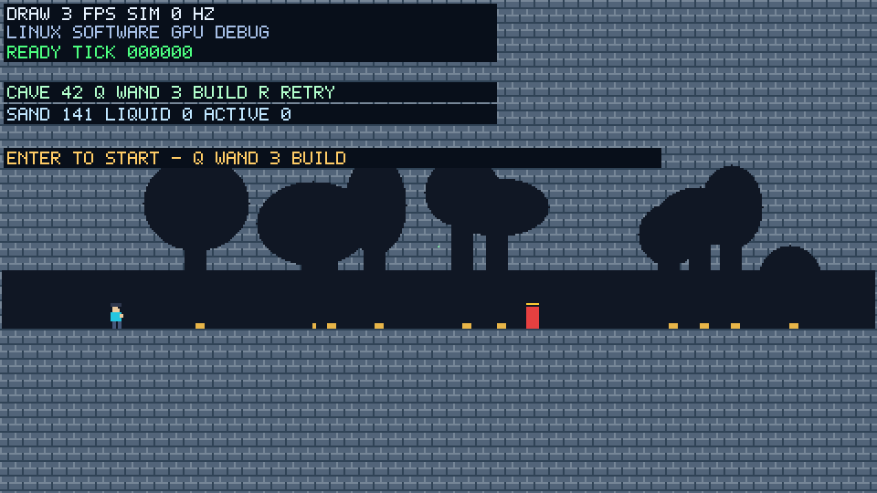
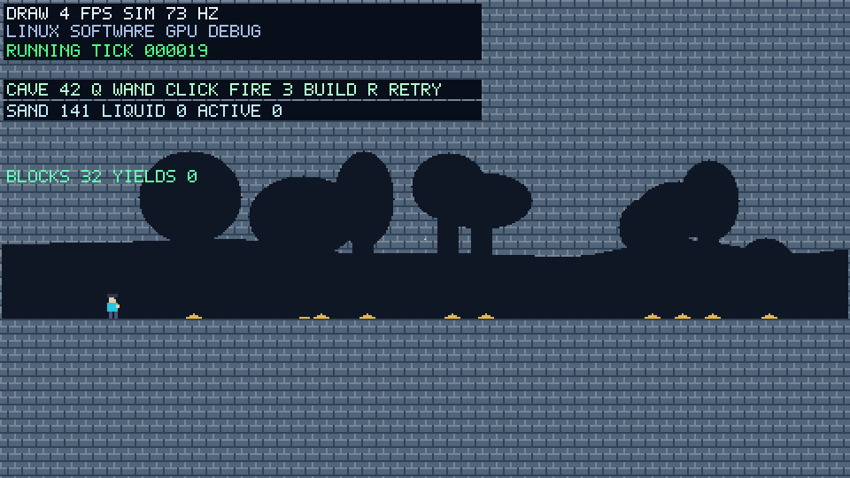
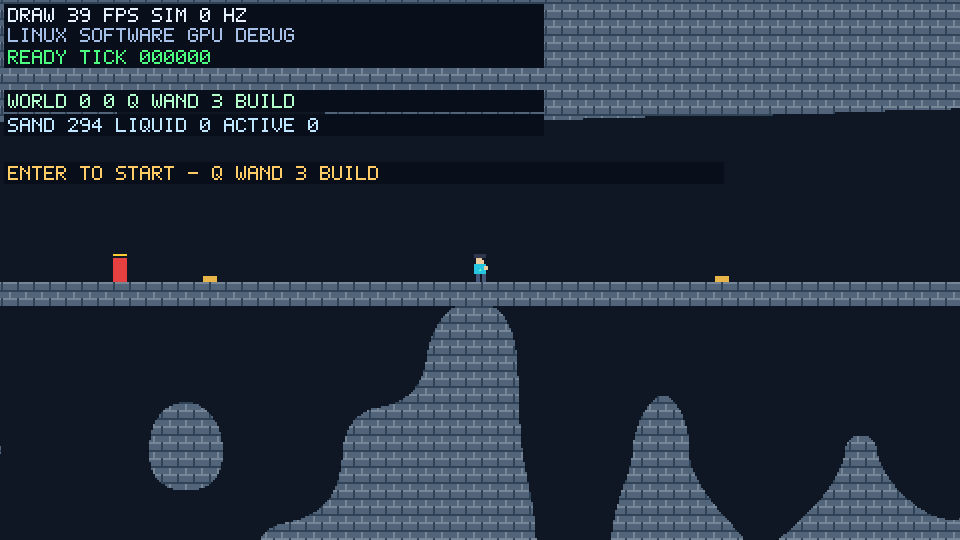
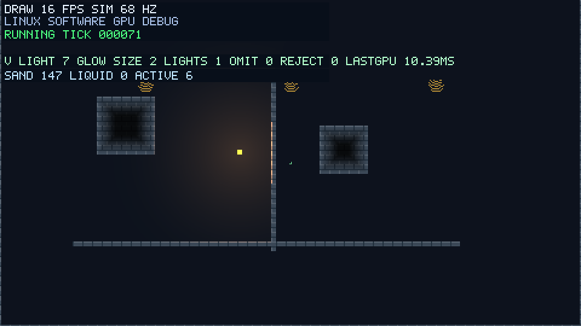

# Charon Engine

壊せる地形と、遊びを組み合わせる2Dゲームエンジン。

Charon Engineは、サンドボックスや横スクロールアクション、会話を中心としたゲームの制作に向けて開発しているRust製エンジンです。作品に必要な機能を選び、地形の変化・キャラクターの操作・物語を組み合わせられることを目指しています。

[導入と使い方](docs/usage.md) · [サンプル](#サンプル) · [ライセンス](LICENSE)

## サンプル

### Exploration

生成された洞窟を探索し、地形を掘り、ブロックを置き、狙いを定めて敵と撃ち合えます。倒れたら同じマップに再挑戦できます。



[探索と戦闘の操作方法](docs/usage.md#探索と戦闘)

地形を円形の範囲で少しずつ削れます。半分まで削れたブロックはアイテムを落とし、残った欠片は砂のように落下して積もります。



広い世界にも探索と戦闘をつなぎ、終了後は保存した続きから再開できます。



[大きな世界で戦う](docs/usage.md#大きな世界で戦う)

### Sandbox

砂を降らせて積もらせ、壁を描き、支えを壊して地形の変化を試せます。


[Sandboxの操作方法](docs/usage.md#sandbox)

### Fluids

海へ砂を落とすと水が押しのけられ、岸へあふれる様子を試せます。


コップを揺らすと水面に波が生まれ、加えた油は水の上へ浮かびます。


仕切りのある容器へ、水が崩れて広がる様子も試せます。


[流体テストの操作方法](docs/usage.md#流体テスト)

発光するブロックで地形を照らし、壁を削ると穴を通って光が届きます。塊の内側ほど暗くなる陰影も試せます。



[照明の操作方法](docs/usage.md#地形の照明)

### Platformer

砂や壁を足場にして移動・ジャンプ。足元を掘ると支えがなくなり、キャラクターが落下します。


[Platformerの操作方法](docs/usage.md#platformer)

### Dialogue

文章を読み進め、選択肢によって物語が分岐する会話サンプルです。BGMや効果音を鳴らし、途中の進行を保存して再開できます。


[Dialogueの操作方法](docs/usage.md#dialogue)

## 環境構築

Rust stableとGitを用意し、[環境別の導入手順](docs/usage.md#必要な環境)に沿ってリポジトリを取得します。取得したフォルダーで、サンドボックスを起動できます。

```bash
cargo run --locked --release -p charon-sandbox
```

Windowsでの起動、各サンプルの操作、対応範囲は[導入と使い方](docs/usage.md)を参照してください。検証方法は[こちら](docs/usage.md#検証)にまとめています。

## License

[MIT](LICENSE) © 2026 sofia gros

同梱フォントは[SIL Open Font License](samples/dialogue/assets/OFL.txt)です。
