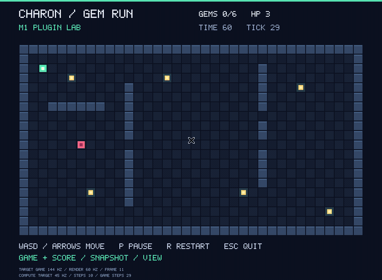
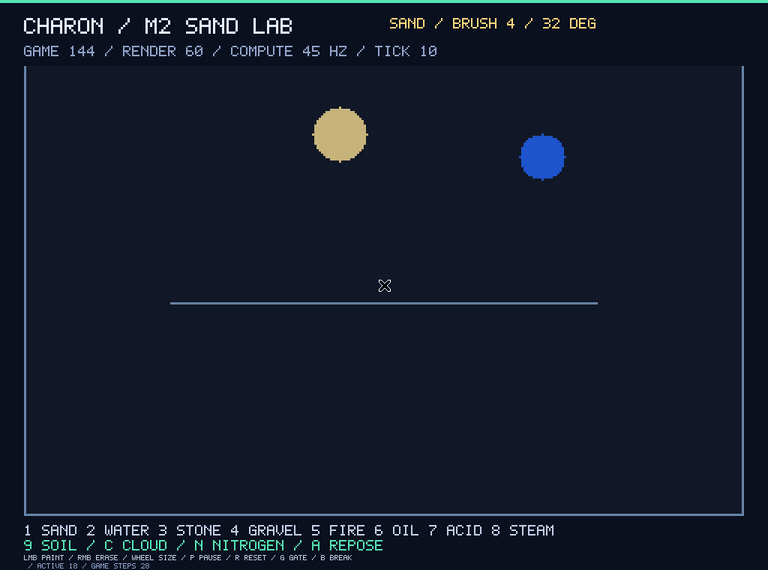
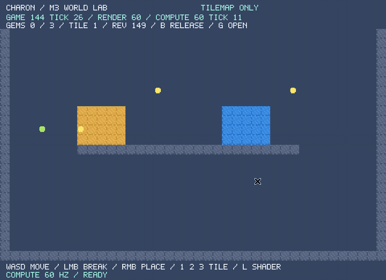
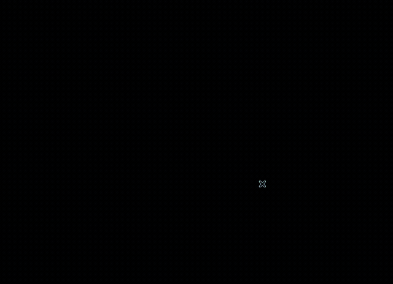
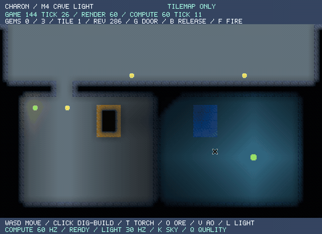

# charon-engine · [](./LICENSE) [](https://github.com/sofia-gros/charon-engine-new/actions/workflows/ci.yml)

charon-engine は、軽量かつ高性能な、Plugins を組み合わせて使う Rust 製の2Dゲームエンジンを目指すプロジェクトです。Terraria のようなタイルマップ主体のゲームと、Noita のように Falling Sand を組み合わせたゲームの両方を作れる構成を目指します。

- **小さな Core：** Core は Plugin の登録、ライフサイクル、更新順序、イベント・リソースの受け渡しを担当します。物理世界や描画方式を固定しません。
- **独立した部品：** Falling Sand、Tilemap、Sprite、Rendering、Lighting、Assets、Input、Camera / Scene を独立した Plugins として組み合わせます。各機能のロジックをライブラリとして分離し、Plugin は Core への接続を担います。
- **TilemapとFalling Sandの連携：** 任意のBridge Pluginで双方向コリジョンを接続し、ブロックの破壊から砂・水を生成する規則もゲーム側で制御できるAPIを用意します。Tilemapのみ・Falling Sandのみでも利用できる構成を維持します。
- **共有できるライティング：** Tilemap と Falling Sand のどちらからも、共通の遮光・発光データへ変換して照明を計算します。照明の計算と描画への適用も分離します。
- **選べる抽象度：** 各部品を直接使える低レベルAPIと、Plugins を登録してゲームを起動できる高レベルAPIを公開する方針です。

たとえば、Tilemap と Sprite を使う2Dゲーム、Falling Sand を使うサンドボックス、Falling Sand を背景に使ったノベルゲーム。必要な Plugins を選んで構成できるエンジンにしていきます。Falling Sand を使わないゲームも、同じ Core で動かせることを設計条件にします。

標準はマルチスレッド構成です。ゲーム144Hz・レンダリング60Hz・計算30〜60Hzを独立した目標周期とし、各レーンをスナップショットとコマンドで接続します。シングルスレッドは検証・デバッグ向けです。

## 開発状況

大きな目標と実装ごとの小さな目標は、[ロードマップ](./ROADMAP.md)にまとめています。

M4までの基盤を実装しています。Core、独立した物理ライブラリ `charon_physics`、Falling Sand Plugin、API経由の物質登録と独自更新、物質ごとの安息角を利用できます。共通光学データを入力とする照明のCPU参照・GPU計算・描画合成も分離しています。物理実装の出発点は[Sandengine](https://github.com/Ijtihed/sandengine)で、元のMIT表記を保持しています。

| 機能 | 状況 |
| --- | --- |
| セル単位の物理演算、密度による移動、燃焼・蒸発・溶解などの反応 | 実装済み |
| 2バイトのセルデータ、32×32チャンクによる更新対象の管理 | 実装済み |
| 粒子を押しのける可動ブロック | 実装済み |
| Falling Sand Plugin、外部コリジョン・生成要求・結果・接触API | M2実装済み |
| API経由の物質登録、独自コールバック、物質ごとの安息角 | M2実装済み |
| 独立したTilemap / Spriteと、任意のFalling Sand Bridge | M3実装済み |
| Assets Plugin、型付きハンドル、PNG・Shaderソースの読み込み・解放 | M3実装済み |
| Rendering Plugin、汎用描画パケット、wgpu、カスタムShader・診断 | M3実装済み |
| 共通光学データ、遮光・伝播・AO・発光、独立したGPU計算と描画合成 | M4実装済み |
| 低レベルAPIの整備と高レベルAPIの公開 | 物理コアのAPIを公開済み。全体の整備は計画中 |
| Input、Cameraの移動・ズーム・逆変換、Sceneとリソース所有権 | M5実装・完了検証中 |
| Coreによる静的Pluginの登録・依存解決・更新・終了、型付きリソースとイベント | M1実装済み |
| Windows 11向けM1ゲームサンプル（宝石収集ゲーム） | ソース・起動コマンド・自動確認を用意。実機確認待ち |

軽量・高性能はエンジン全体の開発目標です。物理更新時の全セルコピーを削除し、固定seedでの[性能測定基準](./docs/performance/README.md)を用意しました。公開用snapshotのコピーなど、引き続き最適化の余地があります。安息角は物質ごとに設定でき、砂の標準値は32°です。セル単位の速度、温度伝導、粘性・表面張力は今後の拡張です。

## M実装事例

実際のサンプルウィンドウにキー・マウス入力を送り、画面をGIFとして録画しています。以下はLinuxの仮想ディスプレイ上での記録で、Windows 11実機での確認を示すものではありません。

### M1：Plugin基盤・ゲームサンプル



[録画環境・対象コミット・操作内容](./docs/demos/m1-demo.json)

[Gem Run](./samples/m1-plugin-game/README.md) で、Pluginの組み合わせ、固定tick、イベントによる得点処理を確認できます。Rust導入済みのWindows 11では、リポジトリのルートから次のコマンドで起動できます。操作・実機確認のチェックリストはサンプルのREADMEを参照してください。

```sh
cargo run --release -p charon-m1-sample
```

各マイルストーンの実装完了時に、ゲームサンプルと操作GIFを用意し、GIFをGit管理してこの節に埋め込みます。

### M2：Falling Sand・物質登録・安息角



[録画環境・対象コミット・操作内容](./docs/demos/m2-demo.json)

[Sand Lab](./samples/m2-sand-lab/README.md) で砂・水などを配置し、外部の障壁を解除したり砂へ変換したりできます。

```sh
cargo run --release -p charon-m2-sample
```

[物理API](./docs/falling-sand-api.md)と[物質の登録・独自更新API](./docs/materials.md)を公開しています。Cで雲、Nで窒素、9で土を選択し、Aで選択中の粒状物質の安息角を切り替えられます。

### M3：Tilemap・Sprite・Assets・GPU描画・Falling Sand連携




[World Labの操作方法](./samples/m3-world-lab/README.md) / [連携APIと各crateの境界](./docs/m3-api.md) / [連携録画情報](./docs/demos/m3-demo.json) / [Tilemap単体録画情報](./docs/demos/m3-tilemap-demo.json)

```sh
# Tilemap + Falling Sand
cargo run --release -p charon-m3-sample

# Falling Sandを依存に含めないTilemap単体
cargo run --release -p charon-m3-sample --no-default-features
```

WASDで移動して宝石を集め、左クリックで破壊、右クリックで設置します。Gで床を開き、Bで砂・水のブロックを粒子へ変換できます。LはカスタムShaderのパラメータ切り替えです。粒子を覆う固体の設置は拒否し、変換規則と追加の設置制約はゲーム側で定義できます。ライティング基盤は次のM4で実装します。

### M4：独立したライティング基盤





[連携録画情報](./docs/demos/m4-demo.json) / [Tilemap単体録画情報](./docs/demos/m4-tilemap-demo.json)

[Cave Light](./samples/m4-cave-light/README.md)では、松明・発光鉱石・火の粒子と、洞窟の遮光・光の伝播・接触部のAOを確認できます。照明の計算はGPU Compute、合成は別の描画Shaderです。TilemapとFalling Sandは共通の光学データへ接続します。

```sh
cargo run --release -p charon-m4-sample
cargo run --release -p charon-m4-sample --no-default-features --features lighting
```

[照明API](./docs/lighting-api.md) / [CPU・GPUの数値・画像・計測記録](./docs/performance/m4-lighting.md)。Tは松明、Oは鉱石、Gは通路、VはAO、Lは照明合成の切り替えです。

### M5：Input・Camera・Scene

[Scene Lab](./samples/m5-scene-lab/README.md)では、開始画面とゲームの切り替え、Cameraの移動・ズーム、変換後の地形編集、Scene再開始を確認できます。旧Sceneのworkerを停止し、入力・アセット・GPUリソースを解放します。

```sh
cargo run --release -p charon-m5-sample
cargo run --release -p charon-m5-sample --no-default-features --features lighting
```

[Input / Camera / Scene API](./docs/input-camera-scene-api.md)。現在は完了検証と操作GIFの反映を進めています。

## 開発環境

Edition 2024に対応した最新のstable Rustを使用してください。ゲームサンプルの起動コマンドは上の各実装事例に記載しています。

物理ライブラリのcrate名は `charon_physics` です。APIの利用方法は[物理APIドキュメント](./docs/falling-sand-api.md)を参照してください。

## ドキュメント

現在の物理ライブラリは、次のモジュールから構成されています。

- [Grid](./src/sim/grid.rs)：セルの格納、ダブルバッファ、チャンクの更新管理
- [MaterialRegistry](./docs/materials.md)：物質の登録、密度・移動・色・安息角・独自更新
- [Physics](./src/sim/physics.rs)：物質ごとの移動と反応
- [Block](./src/sim/block.rs)：可動ブロックと粒子の押し出し

[M3のAssets / Tilemap / Rendering / Bridge API](./docs/m3-api.md)と、[Core / Pluginの契約](./docs/architecture.md)も参照してください。`charon-core` は物理・描画・ウィンドウに依存しません。

APIドキュメントは `cargo doc --no-deps --open` で確認できます。Camera / Scene や Plugins のAPIは、実装に合わせて整備していきます。

## コントリビュート

バグ報告、改善案、Pull Request を歓迎します。[Issues](https://github.com/sofia-gros/charon-engine-new/issues) で、不具合の再現手順や作りたい機能を共有してください。

変更時は、以下のチェックを実行してください。

```sh
cargo fmt --all -- --check
cargo clippy --workspace --all-targets --all-features -- -D warnings
cargo test --workspace
cargo build --release --workspace
```

物理処理のベンチマークは `cargo bench` で実行できます。CIでも Linux / macOS / Windows でフォーマット、Clippy、テスト、リリースビルドを確認します。

## ライセンス

[MIT](./LICENSE)。元のコードの著作権表記を保持し、変更分に `Copyright (c) 2026 sofia-gros` を追加しています。
