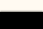
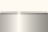
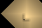

# M4：照明の数値・画像・計測

[生データ](./m4-lighting.json)は、Linux / Vulkan llvmpipe（ソフトウェアドライバー）、releaseビルドで取得しました。Rustの版、ソースのSHA-256、PNGのSHA-256も保存しています。Windows 11実機の性能結果ではありません。

## 比較対象

地表、密閉洞窟、細い通路の開閉、色付きの透過、接触部のAO、発光鉱石とその削除、点光源の移動・削除、画面外光源、伝播0回・1回を比較します。14シーン×照明セル1 / 2 / 4単位、合計42ケースです。

各ケースでGPU結果をreadbackし、CPU参照実装のRGBとAOを全セルで比較します。許容誤差は0.0002、保存した結果の最大誤差は約 `2.98e-8` でした。GPUバックエンドを同じ解像度で使い回し、削除・移動・閉鎖で古い光が残るケースも検出します。

画像を指定して実行した場合、セル2単位の全14シーンについてCPU/GPUのPNGを保存して再デコードし、RGBの差が最大1階調以内であることを確認します。リポジトリには代表6シーンの画像ペアを保存しています。画像は照明場そのものを表示用gammaで可視化したもので、ゲーム画面の録画とは別です。

| ケース | CPU参照 | GPU Compute |
| --- | --- | --- |
| 密閉洞窟 |  |  |
| 細い開口 |  |  |
| 接触部とAO |  |  |
| 発光鉱石 |  |  |
| 色付き透過 |  |  |
| 画面外光源 |  |  |

## 時間・転送・メモリ

共通の計測領域は96×64ワールド単位、最大伝播距離は64単位です。解像度ごとに2回warmupした後の各シーン1回の診断値です。起動時のwarmup値もJSONのstartupへ残しています。定常fpsやp95を示す測定ではありません。

| 照明セル | 解像度 | GPU時間の範囲 | 更新時の入力転送 | 常駐データの論理量 |
| --- | --- | --- | --- | --- |
| 1単位 | 96×64 | 0.147〜7.494ms | 294,976 bytes | 712,784 bytes |
| 2単位 | 48×32 | 0.088〜1.801ms | 73,792 bytes | 178,256 bytes |
| 4単位 | 24×16 | 0.052〜0.472ms | 18,496 bytes | 44,624 bytes |

GPU時間は対応端末のtimestamp queryで取得し、Computeパスとその間の同期を含みます。対応しない端末ではnullです。`encoding_us` はCPUでの変換・提出、`readback_completion_us` は診断時の待機と転送を含みます。通常の描画はGPU結果テクスチャを直接共有するので、このreadbackを行いません。

常駐量は光学入力、種、base、ping/pong、結果、RGBA8テクスチャ、uniform、query結果の論理バイト数です。ドライバー内部の領域やアラインメント分は含みません。readback用の一時バッファも別です。

ゲームサンプルの標準領域は320×192、照明セル4単位で80×48です。こちらは更新時の入力184,384 bytes、常駐約435KiB、伝播32回＋種と仕上げの計34 dispatchになります。上表とは領域が違います。liveシーンの計測値は `charon-m4-sample --gpu-check` が出力します。

## 再実行

```sh
cargo run --release -p charon-lighting-check -- m4-report.json m4-images
python scripts/check_lighting_profiles.py
```

`charon_lighting` のCPUテスト、各アダプターのテスト、依存境界チェック、実ウィンドウのCompute／合成テストもCIで実行します。LinuxのウィンドウテストはXvfbとMesaを使います。Windows/macOSのビルド・テストと、Windows 11実機の表示・入力確認は区別します。

M4では照明のdirty領域を物理とは別に管理しますが、変更時には照明領域を全再計算します。大きい世界での領域分割・部分更新・測定回数を増やした性能評価は、引き続き最適化の対象です。
