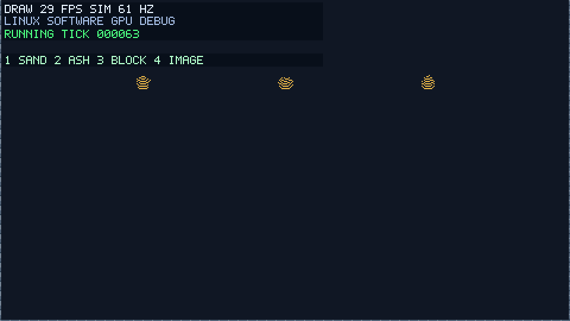
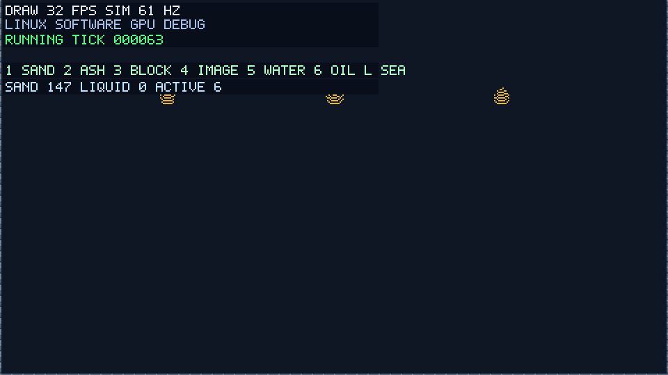
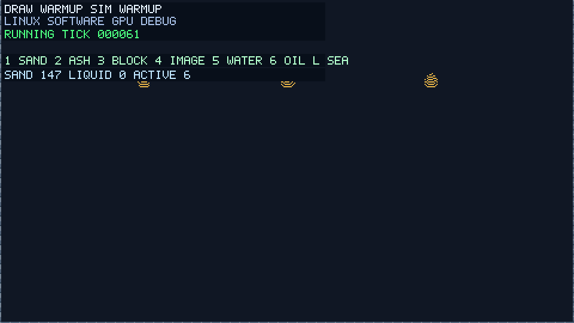
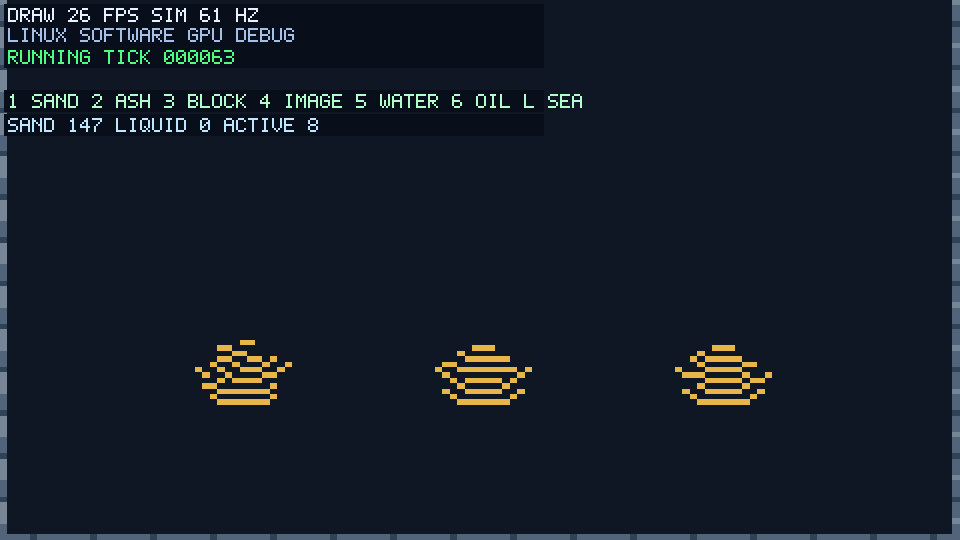
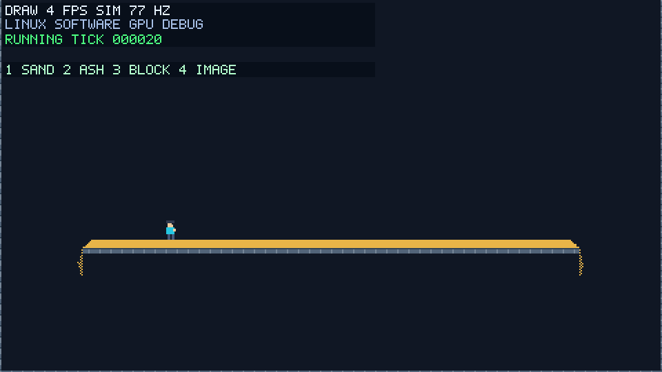
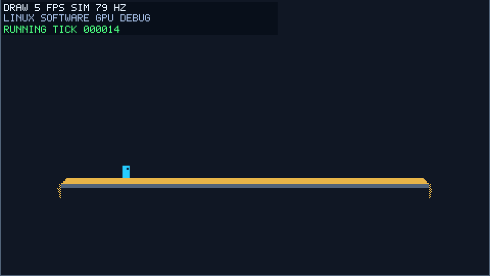
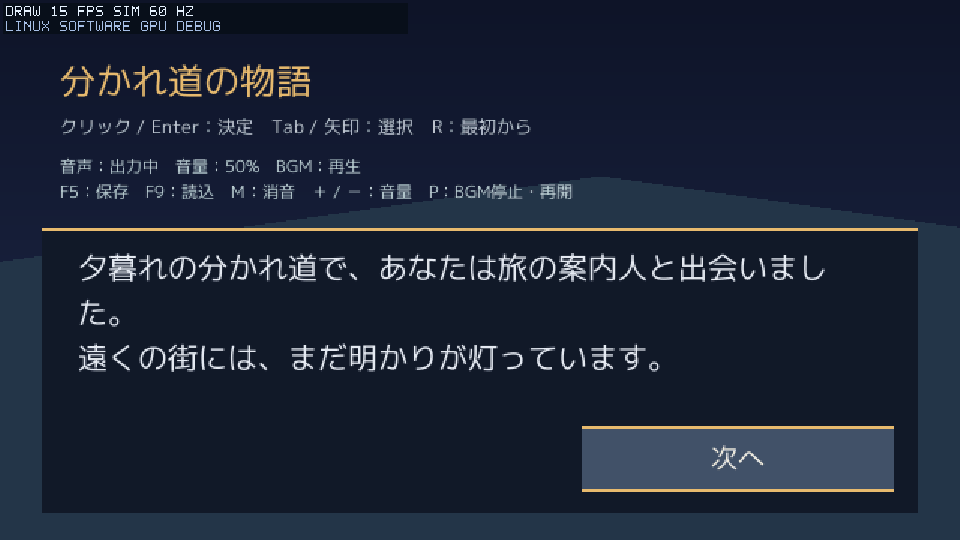

# 導入と使い方

## 必要な環境

- Rust stable、Git。
- Windows 11: MSVC版Rust用のMicrosoft製リンカーとWindows SDK（Visual Studio Build Toolsから導入可能）。既にRustのexeをビルドできれば追加導入は不要。エンジンはRust、shaderはWGSLで記述する。
- Linux: Cリンカ、X11、VulkanまたはOpenGL ESドライバ（CFDのGPU computeにはVulkanが必要）。音声pluginのビルドには`pkg-config`とALSA開発パッケージ（Debian/Ubuntu: `libasound2-dev`）が必要。クラウドの`setup.sh`は管理環境向けにローカル導入も行う。ウィンドウ不要のCPU検証も可能。
- `rust-toolchain.toml` はstableを指定する。更新は `rustup update stable`。依存バージョンはCargo.lockで管理する。

```console
git clone --branch codex/engine-bootstrap https://github.com/sofia-gros/charon-engine-new.git
cd charon-engine-new
```

開発ブランチを確認する場合は、そのブランチをcheckoutしてから起動する。

## Sandbox

壁を描く→砂を積もらせる→壁に穴を開ける→リセットする、実際のマウス/キー入力とウィンドウ描画の記録。Linuxの仮想画面とソフトウェアGPUで約14秒収録。フルHDの画面を動画では960×540に縮小し、8fpsを目安にキャプチャしている。動画のfpsはエンジンの性能値ではない。


WindowsのPowerShell:

```powershell
powershell -NoProfile -ExecutionPolicy Bypass -File scripts/run.ps1
```

このプロセスだけローカルスクリプトを実行し、恒久的な実行ポリシーは変更しない。通常の開発中は `-DebugBuild`、比較時は `-Workers 1` / `-Workers 4`、密度変更は `-Grid 960x540` を指定できる。既定はrelease、4ワーカー、480×270セル。

Linux、または直接Cargoで起動:

```console
cargo run --locked --release -p charon-sandbox -- --workers 4 --record artifacts/local/metrics.csv
```

クラウドでは先に `source scripts/env.sh` を実行する。GPUのない管理環境ではSwiftShaderを選び、画面にはSWGPUと表示する。大きなCFD領域の日常確認は`--fluid-backend cpu`を選び、GPU computeの正しさは小領域でも確認する。初回/依存更新時のみ `bash scripts/setup.sh` を使用する。

ウィンドウの初期サイズは1920×1080。1で砂・2で紫色の灰を選び、左ドラッグで配置、右で消去、中でグリッドブロック、Rで初期化、Escで終了。表示サイズとセル数は独立している。端の壁と床は消去できない。

画面内にDRAW FPS・SIM Hz・GPU種別・ビルド種別を表示する。DRAWは描画送信回数を実時間で割った値、SIMは物質更新回数を実時間で割った値。最初の計測区間はWARMUPとなる。タイトルにはさらにtick処理時間・使用/設定ワーカー数・砂の数・フレーム間隔p99を表示する。休止時は使用ワーカー0になる。描画は最大144 FPSを狙い、シミュレーションは別スレッドの固定60 Hzで進む。

PowerShell起動では `artifacts/local/` に時刻付きCSVとRustバージョンを保存する。通常モードのCSVは1秒区間の値で、tick処理時間は直近tickの値。更新/画像生成の時間は直近tick、upload_enqueue_ms・upload_bytes・acquire_ms・encode_present_msは直近描画のCPU側呼び出し時間と転送要求量。converted_cellsは直近tickで画像へ変換したセル数。描画のGPU実行時間や物理的な画面提示はまだ測定していない。CFDのcompute GPU時間は下記のタイムスタンプで別に記録する。VSyncやOSのスケジューリングも描画FPSへ影響する。

## ブロックと画像の配置

配置方法は対象ごとに選ぶ。サンプルでは1/2が砂/灰ブラシ、3がグリッドブロック、4が自由配置の画像。3では左ドラッグで8×8セルの壁を配置、右でそのマスを消去する。通常ブラシ中の中ボタンも同じグリッドブロックを置く。グリッドの原点は世界座標に固定され、カメラが動いてもずれない。

4では左クリックで画像を1枚置き、右クリックで指した画像のうち最前面の1枚を削除する。画像の左上がマウス位置になり、小数座標も保持する。配置済み画像は地形・当たり判定・物質計算へ影響しない。停止中も配置でき、Rで消去する。サンプルの上限は128枚で、超えると画面に通知する。枠は配置の予告位置を示す。画像はデモ用のキャラクター絵を共用している。



`python3 scripts/capture-linux.py --sample placement`でグリッド整列・小数座標の保持・ズーム後の配置・削除・入力再生を確認できる。[入力列](media/placement-linux.trace)も`--replay`で再生できる。画像の座標は浮動小数点のビット列で保存する。

共通APIの`Placement::Grid { origin, cell }.position(point)`はマスの左上へ合わせ、`Placement::Free.position(point)`は座標をそのまま返す。8×8はサンプルの設定で、エンジンの固定制約ではない。ノベルの立ち絵やアクションのスプライトは自由座標を使え、描画時にグリッド吸着を強制されない。地形pluginは汎用の`FillRect`を受け取り、配置方法やブロック寸法はゲーム側が決める。

## ゲーム側の素材定義

[samples/sandbox/src/materials.rs](../samples/sandbox/src/materials.rs)で素材のキー・単色表示・動き・足場判定・弾の遮蔽を定義し、`SandWorld::with_materials` / `from_material_cells`へ渡す。`demo.ash`は落下・堆積し、足場にならず弾は遮る粉体。素材追加にCoreや砂plugin本体の編集は不要。表は起動時に検証され、世界作成後は不変。IDは表内の位置で、現在の上限256種を超える登録、重複キー、不正な境界はエラーになる。`Frame.sand`とCSVのsand列は互換名で、現在は全粉体のセル数を表す。

現在の動きは空・静止・粉体・液体。`Material.density`は相対密度で、重い粉体/液体は下の軽い液体を押しのける。足場/弾の判定は密度と独立。独自の反応ルールや汎用plugin依存解決はまだ実装していない。見た目は別の[material_view.rs](../samples/sandbox/src/material_view.rs)で素材キーへ割り当てる。壁の繰り返し画像と灰の3フレームアニメーションを共通描画基盤へ渡し、物質の休止/停止を解除せずに表示を更新する。

## 流体テスト

SandboxでLを押すと左に海、右に砂の岸を作る。1で砂を選び、海の上の空中に左ボタンを押し続けて大量に落とす。5で水、6で油を選べる。画面にはSAND/LIQUIDのセル数とACTIVE区画数を表示する。素材ブラシは既存セルを置き換える編集操作なので、水中へ直接描く場合はその水を置換する。砂による押しのけを試すときは空中から投入する。


`python3 scripts/capture-linux.py --sample sea`で実入力と約40秒のGIFを再生成する。水量を維持したまま砂が沈み、水が岸へあふれること、静止後のセル更新/画像生成/地形転送ゼロを検証する。[入力列](media/sea-linux.trace)は`--replay`で1workerでも同じ状態を確認できる。[記録条件と結果](media/sea-linux.json)・[状態CSV](media/sea-linux.csv)を同梱する。

セル液体は落下と水平流路の均し、密度差による交換を行う。各物質のセル数を保ち、決定的な競合解決で1セルが1tickに複数回移動することを防ぐ。流路は活動行で共有して探し、行内の遠い穴も検知する。地形変更時は関連する水平帯を再起床し、深い静止水を常に全走査しない。静止水面の高さは1セル分の差まで許す。

受入例①の海と砂はセル液体を使う。②のコップの慣性波と水/油の分離、Hの水柱崩壊は下記の連続体CFDを使う。回転・燃焼等の反応・表面張力・液体から剛体への変換は後続の機能。

### 動くコップ・波・油

Kでコップと水を作り、A/Dまたは左右キーで並進、Oで油を追加する。Hは内部に仕切りを持つ容器で水柱が崩れる例。Pは停止/再開、Nはコマ送り。形状・移動速度・素材との対応はゲーム側の[cup.rs](../samples/sandbox/src/cup.rs)に置く。水面の形を入力に合わせて描く処理はなく、容器の加速・停止・反転を流体の慣性へ渡す。一定速度での並進は力を加えない。



`python3 scripts/capture-linux.py --sample cup`で実ウィンドウと入力を収録し、各相の体積保存・圧力投影後の発散・液面の往復・停止/休止・1ワーカーでの再生を検証する。[結果JSON](media/cup-linux.json)・[状態CSV](media/cup-linux.csv)・[入力記録](media/cup-linux.trace)を同梱する。HUDの水/油は、連続した体積をセル面積に換算した値。CSVには丸め前の体積も記録する。GIFの収録fpsは描画/シミュレーションの速度ではない。

[charon-fluid](../plugins/charon-fluid/src/lib.rs)は砂に依存しないRust製のEuler型流体部品。格子上の速度・圧力と2相の占有率を持ち、個々の粒子を追跡しない。非圧縮流れの慣性・重力・基準座標系の加速度・線形抵抗を扱い、MAC格子で速度移流と可変密度の圧力投影を行う。有効動粘性`Config.viscosity`による速度拡散も計算する。例の設定は0.5セル²/秒、線形抵抗0.8/秒。CPU基準版はMIC(0)で前処理した共役勾配法を使い、圧力の前回解を再利用する。圧力反復は液体セルだけの連続配列で処理し、空気の配列を反復走査しない。液体の占有位置を圧力境界の距離へ反映する。相の移流は有限体積法と幾何VOFで、セル内の界面を平面として再構成し、面を横切る体積を運ぶ。水/油は別の体積として保存され、界面を含むセルで両相が存在しても溶解を意味しない。

流体の連続性は水面の高さ1本に限定しない。凹型・仕切り・開口等のセルマスク、液体の分裂・合流、分離した液滴を扱える。`Fluid::new(Config, solid)`で有限の閉境界領域を作り、`add`で指定相の体積を空きへ追加、`set_solid`で形状を編集する。液体へ壁を挿入して物質を消す操作は拒否する。失敗したtickは速度・圧力・体積を巻き戻す。CFL条件で時間を分割し、体積制限は共有する面流量へ適用する。丸め残差も物質の削除ではなく接続した領域への保守的な再分配で処理する。

静止時は流体更新を休止し、編集や加速度変更で再開する。休止の許容値は`Config.sleep_tolerance`で明示指定し、0で無効化できる。例では各セルの運動水頭0.005セル・1tickの相占有率変化0.005以下が60tick続くと休止する。気体側へ延長した速度や、動く小領域を隠す世界平均だけでは判定しない。CFLと運動エネルギーはセル内の液体多角形上で評価し、空気部分の速度で時間分割や休止を誤判定しない。`Config.pressure_cutoff`は独立した圧力自由度を持つ最小占有率で、例では0.01。下回る体積もVOFに残して保存し、速度は近傍場から補間する。活動中は速度の作業範囲を液体周辺へ絞るが、圧力の伝達に必要な液体内部は解く。CPUの速度移流はRayonで並列化し、競合しない書込先へ出力する。圧力の内積と適用順は再現性のため決定的に処理する。描画は体積から作る別のビューで、同じ素材の内部タイルを保持し、変更したタイルだけをGPUへ送る。表示に使う占有率の閾値は物理的な体積を削除しない。

現段階のCFDはセル形状・2相・共通の並進座標系を扱う。コップの最小グリッドは128×100。ゲーム側が流体を所有し、砂側のセル移動とは重複して計算しない。CFDの例は形状を固定した並進座標系で解き、計算領域の外周もその座標系に属する。まだ連成していない地形/砂ブラシは例の実行中に拒否するため、RまたはLで通常のSandboxへ戻して使う。砂との双方向結合、回転する壁、相ごとの粘性・表面張力・圧縮性の気体は後続の機能。離散化には数値拡散とセル解像度による誤差がある。Windows実機性能は未確認。

手法の基礎はHarlow/Welchの[MAC法](https://doi.org/10.1063/1.1761178)、Hirt/Nicholsの[VOF法](https://doi.org/10.1016/0021-9991(81)90145-5)。この実装では静水・床上の薄い液体・液体領域上のエネルギー積分・粘性による運動の減衰・重力/抵抗による落下の解析解・障害物を回り込むダム崩壊・相別保存・1/4ワーカー一致を回帰検証する。



`python3 scripts/capture-linux.py --sample fluid-dam`でHの例を収録する。[結果JSON](media/fluid-dam-linux.json)・[状態CSV](media/fluid-dam-linux.csv)・[入力記録](media/fluid-dam-linux.trace)を同梱する。

従来のセル液体と汎用キネマティック境界も`charon-sand`に残る。`add_obstacle`/`move_obstacle`は1セルの移動、接続した液体列の体積転送、失敗時の原子的な取消しを提供する。マスクは16384セル、探索は1移動262144訪問以内。Clear前のハンドルは再利用しない。海と砂の受入例は引き続きこの経路を使う。

性能記録の`headless_replay`は、描画を除いた4ワーカーの入力再生時間をCFDの物理tick数で割った平均上限。停止中の処理・画像生成・全状態の照合も含み、最悪tick時間やWindows性能の測定ではない。同じ入力は`target/debug/charon-sandbox --replay docs/media/fluid-dam-linux.trace --workers 4`で再生できる。強い崩壊/飛沫ではクラウドの描画込み60Hzを下回るため、本格CFDをGPU compute主体とし、CPUを検証/代替用に残す方針。上の480×270のGIFはCPU基準版。GPU経路の検証記録とは区別する。

サンプルは`--fluid-backend gpu`が既定で、速度移流/粘性と圧力反復をwgpu computeで計算する。`--fluid-backend cpu`（Windows起動スクリプトでは`-FluidBackend cpu`）でCPU基準版を選べる。GPU初期化失敗時は理由と代替オプションを表示し、黙って経路を変えない。plugin単体は`gpu` featureを有効にし、共有する`GpuContext`を`Fluid::use_gpu`へ渡す。体積を所有する幾何VOF・境界係数生成・力/速度延長は現段階でCPU側に残る。 GPUの速度移流/粘性は液体の外接矩形に従来と同じ3セルの帯を加えた範囲だけを計算し、その出力だけを読み戻す。矩形外の速度はCPU側で0にし、縮小前の値を残さない。離れた水域の間の空気は矩形に含まれる。入力速度は遠方の逆追跡/補間を保持するため、現段階では全領域を転送する。

CFDの`Stats.gpu`はGPU経路でのみ存在し、速度/圧力のcompute passをGPUタイムスタンプで計測する。CSVの`fluid_gpu_velocity_ms`/`fluid_gpu_pressure_ms`は全substepと再試行の合計。既存の`fluid_velocity_ms`/`fluid_pressure_ms`はCPU側の作業・転送・GPU待ちも含む経過時間なので、GPU時間と区別する。`fluid_gpu_upload_bytes`/`fluid_gpu_readback_bytes`は明示的なGPU入出力量、`fluid_gpu_dispatches`はそのtickのcompute実行回数。読み戻し量はタイムスタンプとアラインメント領域を含む要求範囲で、PCIe上の実トラフィックを測った値ではない。値は直近の物理tickについての値で、停止中はその値を保持し、休止tickでは0になる。 `fluid_pressure_assembly_ms`はCPUでの係数/右辺等の組立、`fluid_pressure_setup_ms`はGPU圧力系の準備とf64残差検査にかかった時間。後者はGPU solve呼出しの外側を測り、小領域では転送のenqueueも含むが、全CPU処理や全転送を網羅する値ではない。`fluid_gpu_readbacks`は収束判定/結果取得/速度段階の読戻しを伴う送信の回数で、待ち時間そのものとは区別する。 `Stats.velocity_extension_ms`/CSVの`fluid_velocity_extension_ms`は圧力投影後のCPU速度延長で、移流/力の`fluid_velocity_ms`や圧力時間とは別に測る。

タイムスタンプ非対応/無効時のGPU時間は`None`（CSVは空欄、HUDは`GPU TIMER N/A`）とし、CPU時間や0で代用しない。`GpuContext::with_timing(false)`、CLIの`--no-fluid-timing`、Windowsスクリプトの`-NoFluidTiming`で無効にできる。記録形式/物理状態へ影響させず、計測あり/なしで同一状態になることを検証する。タイムスタンプの読み出しは既存の物理結果の読み出しと同じ送信へまとめ、計測専用の追加待機を作らない。静止/休止時はcompute・転送も省く。描画GPU時間、実表示の到達時刻、ハードウェアGPUの性能達成とは別の測定。

GPUの圧力は液体セルだけの連続配列で前処理CGを実行する。8,192自由度未満は1 workgroup内で協調する。接続した近隣セルの局所逆行列とGalerkin粗格子の逆行列を加算する2段前処理で、細かな誤差と水域全体の誤差を補正する。前処理の係数は圧力投影ごとにCPUで生成し、同じ投影内のf64補正ラウンドでは再利用して、GPUの各反復で適用する。セル数に応じて局所ブロックを広げ、粗格子が256個を超える分離した水域等ではGPU内のJacobi前処理に切り替えて密行列の肥大を防ぐ。実GPUは128レーン、CPU型のソフトウェアGPUは4レーンで協調し、ソフトウェアでの過剰な同期待ちを抑える。内積の集計もまとめる。圧力の精度基準やCFL/体積保存の条件は緩めない。8,192自由度以上は128セルを論理ブロックとして複数workgroupへ分散し、集約型multigridの対称V-cycleで前処理する。各段の前後に重み付きJacobiを2回ずつ適用し、残差を接続セルの粗格子へ制限、補正を細格子へ戻す。階層は最大8段、最下層128点以下は有界な逆行列を適用する。密閉成分は定数圧力を除いた対称擬似逆行列で扱い、分離した水域を混ぜない。多数の液滴等で集約が進まない場合は16回の粗格子Jacobiに切り替え、巨大な密行列を作らない。V-cycleの作業配列はGPU内で保持する。 ゼロ初期値からの最初の平滑化は右辺初期化/制限へ、補間と最初の後平滑化は同じdispatchへ、最細段の最後の平滑化はPCGの内積集計へ統合する。隣接値は書込対象とは別の領域から読み、平滑化の回数と対称性を維持する。 最細段ではKrylovの初期化/更新と前平滑化2回もまとめる。最初の平滑化値を近傍の不変な残差からその場で評価し、2回目の結果だけを保存する。古い残差はV-cycle終了まで保持するため、別workgroupの更新中の値を読まない。4近傍の係数は既存の圧力行から参照し、粗い段は可変長の隣接表を使う。ソフトウェアGPUも実GPUと同じ論理ブロック数を発行し、4レーンでは各レーンが複数セルを担当する。内積もGPUで集計し、16反復ずつまとめて実行して小さな収束状態だけを読み戻す。隣接セルの古い探索方向と新しい方向は別領域へ置き、書込中の値を他groupが読まない。分散経路の最後は圧力だけを1セル4バイトへ詰め、Krylov作業配列全体をCPUへ戻さない。

f32の解は元のf64作用素で残差を検査し、追加のGPU補正でCPU基準と同じ許容値へ収束させる。小領域の密閉成分は1点の基準圧力を固定する。大領域は元のNeumann作用素で解き、成分ごとに丸めた右辺の整合性と補正後の圧力の定数分を扱い、一点固定による条件数の悪化を避ける。面ごとの差で作用素を評価するため、可変密度でも定数圧力が余計な力を生まない。圧力の係数と前処理データは投影ごとに1回転送し、f64補正ラウンドでは残差の右辺だけを再転送する。共有GpuContextの作業バッファは投影全体で排他的に保持し、並列の別流体が係数を上書きしない。GPUの入力/作業/読戻しバッファは拡張しながら再利用し、大領域から小領域へ戻す場合も実際の要素数だけをbindする。

`Stats.gpu.velocity_workgroups`/`pressure_workgroups`とCSVの同名列は、そのtickで発行した各段階の最大workgroup数。休止/実行不要なら0になる。CPUワーカー数やGPUの同時実行占有率とは区別する。CloudのSwiftShaderはGPU命令をCPUで代行するため、分散処理の時間をRTX 4060の性能値にしない。ハードウェアGPUで転送/同期を含めた計測を行い、前処理と反復/転送をさらに改善する。

`VK_DRIVER_FILES=/usr/lib/chromium/vk_swiftshader_icd.json cargo test --locked -p charon-fluid --features gpu gpu_ -- --ignored --nocapture --test-threads=1`で実computeを検証する。GPU検証5件で、共有contextで大小の圧力系を並列に解く場合、9,001個の分離成分、計測有無の一致、4/128レーンの可変係数・閉/開境界が分離した437自由度の既知解、521個の分離成分での粗格子制限、既知解5サイズ（37/1,024/4,096/8,209/16,899自由度）、可変密度の閉/開境界の混在、全MAC速度面のCPU比較、密閉容器/水油/液滴の各90tickを確認する。さらに18,432液体セル・144 pressure workgroupの実際のMAC更新で体積/静水/発散、大領域から小領域へ戻すバッファ再利用を確認する。速度の出力矩形については密な領域→四隅→1セル液滴→小さい格子→空の順に同じGPU contextを使い、全MAC面のCPU比較、長い逆追跡、範囲縮小後の0初期化と読戻し量も確認する。アダプター不在なら失敗し、成功扱いでスキップしない。Linux CIにもこの検証を追加している。

同一入力での速度比較は `cargo run --locked -p charon-fluid --features gpu --example wave-cost`。128×100格子にコップを作り、水364・油84、4 CPUワーカー、240回の固定入力で加速/停止/反転する。描画・収録なしで更新時間、圧力反復数、GPU時間、転送量をJSONへ出力し、全tickで相別の体積と発散を検査する。[小領域の初期改善時の計測](benchmarks/fluid-wave-gpu.json)を参照。前処理係数により転送量は増えるため、実GPUでの再計測も必要。GIFの入力は実時間で与えるため、この固定tick計測とは別の負荷であり、GIFのHz範囲を直接の速度比には使わない。CSVの`fluid_pressure_iterations`で直近tickの反復数も確認できる。 [速度出力の範囲限定後の計測](benchmarks/fluid-velocity-region-gpu.json)では同一240tickの速度GPU時間が合計637→145ms、圧力を含む読戻し合計が65.0→19.2MB、平均更新34.4→32.4msとなった。全tickの物理状態を集計したhash・圧力反復・substep・最大発散は一致する。これは各1試行のsoftware GPU値で、全体の主負荷は依然として圧力計算。CPU速度延長は約0.2ms/tickだったため、アルゴリズムを維持して計測だけ追加する。

大領域の固定入力計測は `cargo run --locked -p charon-fluid --features gpu --example pressure-cost`。130×146格子の密閉水槽に水17,408・油1,024を入れ、初期圧力と暖機後を3tickで測る。末尾に `-- --surface` を付けると、水8,320・油768の自由表面に水平加速度40/−40/0を与える。全tickで相別保存・発散、密閉例では静水も確認する。[変更前後の計測](benchmarks/fluid-large-gpu.json)には各tickのCPU側経過時間・GPU時間・反復数・転送量・group数を保存する。GPU検証はこの大領域も対象にし、以下のGIFは既存小領域の画面回帰確認として分ける。 [dispatch統合後の追加計測](benchmarks/fluid-pass-fusion-gpu.json)では同じ自由表面3tickの平均更新時間が322→295ms、dispatch数が2,049→1,475へ減少した。CPU組立は約0.5ms、backend準備は約2.5ms、GPU圧力計算は約263msで、引き続き圧力計算が主な負荷。単一試行のsoftware GPU値で、60Hz達成の根拠にはしない。 続く[最細段統合の計測](benchmarks/fluid-fine-stage-gpu.json)は変更前後を交互に3回ずつ実行し、平均更新295→267ms、dispatch 1,475→1,311回。反復数・発散・最大速度・転送量・読戻し回数は一致し、同じ精度/前後2回ずつの平滑化を維持する。こちらもsoftware GPUのheadless値で、小領域GIFのHzとは比較しない。



`python3 scripts/capture-linux.py --sample fluid-wave --fluid-backend gpu --grid 128x100`は短い慣性波の画面検証。[結果JSON](media/fluid-wave-gpu-linux.json)・[状態CSV](media/fluid-wave-gpu-linux.csv)・[GPU入力記録](media/fluid-wave-gpu-linux.trace)を同梱。GIFは小領域の協調kernelの記録で、分散kernelの確認は上記の大領域検証で行う。往復移動、液面の両方向への傾き、水/油の表示、相別保存、一時停止、入力再生を確認する。静止後の層・深部の空洞・休止まで確認する上のCPUコップ受入例とは範囲を分ける。


`python3 scripts/capture-linux.py --sample fluid-dam --fluid-backend gpu --grid 128x100`で再収録できる。流体格子128×100、描画1920×1080、computeはSwiftShader、描画はllvmpipe。これはGPU経路の動作検証であり、実機GPUの速度を表さない。JSONの`fluid_active_simulation_hz_range`は場面開始直後と停止/休止中を除いた計測区間で、全体の最大値に含まれる流体開始前の60Hzと区別する。[結果JSON](media/fluid-dam-gpu-linux.json)・[状態CSV](media/fluid-dam-gpu-linux.csv)・[GPU入力記録](media/fluid-dam-gpu-linux.trace)を同梱する。

入力記録v4はCPUのCFDコップを対象にする。GPUはv5にアダプター/ドライバー識別値を持ち、別のGPU環境では完全一致の再生を拒否する。GPU間やCPUとの検証は保存量・発散・誤差許容値で比較し、bit単位の互換性を約束しない。v1/v2は当時の素材表、v3は既存の砂/海等を再生できる。計算法が異なる旧コップの記録は明示的に拒否し、v4で再収録する。開発用の再現記録であり、ゲーム保存の長期互換形式ではない。

## Platformer

```console
cargo run --locked --release -p charon-sandbox -- --play --workers 4 --record artifacts/local/platformer.csv
```

Windowsは `scripts/run.ps1 -Play` でも起動できる。既定は480×270セル。A/Dまたは左右キーで移動、Spaceでジャンプ、Fを押している間は足元を掘る。Bで砂の当たり判定を切り替える。Jで右へ発射する。壁は常に足場になる。マウスの砂/壁/消去も使える。Rで地形・プレイヤー・判定設定を初期化する。


物質は砂plugin、移動は砂に依存しないplatformer plugin、両者をつなぐ判定方針はサンプル側が所有する。キャラクターはPNG+JSONシートの待機/歩行アニメーションとしてGPU描画し、地形画像へ焼き込まない。物理の矩形とは独立し、埋まり時は赤いデバッグ矩形を表示する。`upload_bytes` は地形、`overlay_upload_bytes` はデバッグ矩形等、`sprite_upload_bytes` は画像スプライト頂点の転送量。画像本体は初回にアップロードして共有する。操作モードのCSVは約0.1秒ごとに位置・着地・埋まり・砂の判定設定も記録する。

まず軸に沿った矩形とセルの衝突を扱う。薄い床の通り抜けを防ぎ、支えが消えると落下する。回転・坂・セルを押しのける双方向の物理は未実装。新しい地形に埋まった場合は16セル以内の空きへ移し、空きがなければ赤く表示して移動を停止する。周囲の消去かRで戻せる。`python3 scripts/capture-linux.py --sample platformer` で操作検証と録画を再実行できる。

操作を再現するための入力記録:

```console
cargo run --locked -p charon-sandbox -- --play --input-log artifacts/local/session.trace
cargo run --locked -p charon-sandbox -- --replay artifacts/local/session.trace --workers 1
```

記録は物質更新と同じスレッドでtickごとに保存する。CPUの記録はウィンドウ/GPUを起動せずに再生し、地形・位置・速度・判定/入力状態のchecksumを各tickで検証する。不一致は最初のtickを報告して失敗する。Rによる再開も記録される。保存先が既に存在すれば上書きせずエラーになる。記録のIO失敗でも動作を止める。

入力記録はデバッグ用で、IOとchecksum計算の負荷を含む。性能確認では有効にしない。新規記録は素材定義の識別情報を含むv2で、定義の異なる版は再生前に拒否する。既存v1は従来の3素材だけを対象に再生できる。物理ルール変更後の同一結果を保証するゲームセーブ形式ではない。[動画と同時に記録した入力列](media/platformer-linux.trace)も同じコマンドで再生できる。Windowsの記録は `scripts/run.ps1 -Play -RecordInputs`。

## 画像とアニメーション

`charon-assets`の`Texture::load`で単一PNG/JPGを読み、`Atlas::single`で1フレームとして使える。`Atlas::load(image_path, json_path)`はPNG/JPG+JSONのスプライトシートを読む。Aseprite/TexturePacker形式の`frames`オブジェクト/配列に対応し、フレーム名・切り抜き矩形・ミリ秒単位のdurationを扱う。現在は回転/トリミングを無効にして書き出す必要があり、対応外の指定・画像外の矩形は読込時にエラーになる。画像は各辺4096ピクセル以下・圧縮ファイル32 MiB以下、JSONは8 MiB以下が初期上限。

`Clip::new(atlas, &["walk0", "walk1"], true)`のようにゲーム側で待機/歩行/走行/攻撃などを組み立てる。複数クリップで同じ画像を共有し、`frame_at(Duration)`で表示フレームを得る。末尾で止まるクリップも作れる。時刻は呼出側から渡すため、物理時計と見た目の時計を分離できる。読込は開始前に行い、フレームごとにファイルを開かない。

[samples/sandbox/src/actor_view.rs](../samples/sandbox/src/actor_view.rs)は待機/歩行と左右反転の例。`WindowRenderer::upload_sprite_texture`で画像を一度GPUへ送り、`present_tiled_with_sprites`で地形→画像→デバッグ表示の順に描画する。現在の初期上限は1フレーム1024スプライト。回転/トリミング取込は今後の工程。UIは別の画面固定レイヤーへ描画できる。

素材の画像には`present_indexed_with_sprites`を使う。1セル1バイトの素材IDを不変タイルで渡し、GPUが素材の色またはアトラス矩形を選ぶ。現在は共有アトラス1枚・256項目の表示表・画像の繰り返し配置に対応し、透過部分には素材の単色を使う。アニメーションは表示表だけを更新し、静止セルや画像本体を再転送しない。`upload_bytes`はセル、`appearance_upload_bytes`は表示表、`atlas_upload_bytes`は画像本体。CPU側には画素照合用のRGBAスナップショットも保持している。大量画像の自動パックや多アトラスの管理は未実装。

## カメラと描画補間

Cでプレイヤー追従/全体表示を切り替え、=で拡大、-で縮小する。追従へ切り替えると2倍、全体表示に戻すと1倍になる。キャラクターは右移動で右・左移動で左を向き、停止中は向きを保持、Rで右向きに戻る。ズーム範囲は1〜4倍。カメラは描画側だけが所有し、地形・スプライト・世界内の検査枠へ同じ変換を適用する。HUDは画面に固定する。マウスの配置/消去/調査はウィンドウ座標から世界座標へ逆変換するため、追従・ズーム・サイズ変更後も指したセルを操作できる。

共通APIは`Camera2D::new(origin, visible_size)`と`WindowRenderer::set_camera`。RGBA画像/素材ID画像の両方に対応し、世界外は黒で表示する。カメラの変更だけでは地形を再転送しない。`world_to_view` / `view_to_world`でゲーム側の入力と表示を合わせられる。サンプルではカメラを世界の範囲内に制限する。

プレイヤーの表示位置は、物理が渡す直前/現在の位置とSnapshotの`published_at`から補間する。60 Hzの物理に最大1 tick（約16.7 ms）の表示遅延を加え、実行が遅れた場合も現在位置を越えて予測しない。物理位置・当たり判定・入力再生は変更しない。停止/コマ送り/リセット/地形からの強制脱出では正確な位置へ合わせる。現状はプレイヤー位置が対象で、セルや弾・火花の補間は行わない。



`python3 scripts/capture-linux.py --sample camera`で実操作と入力再生を検証する。[入力列](media/camera-linux.trace)はカメラ変換後の世界座標を保存し、描画なしで再生できる。カメラ操作自体の映像再生形式ではない。CSVの`camera_x/y/width/height`は世界内の表示範囲、`display_player_x/y`は表示位置、`player_x/y`は物理位置、`window_width/height`は実ウィンドウの大きさを表す。録画はゲームのクライアント領域だけを撮り、ウィンドウ縮小時のデスクトップを含めない。GIFの収録速度は補間の滑らかさを評価できる速度ではなく、操作と表示の証跡として扱う。

## 弾と破壊

Jで右へ発射する。弾は固定tickで通過セルをたどり、最初の遮蔽物で止まる。素材の`blocks_projectiles`で判定し、ゲーム側が命中要求から7×7セルの穴と短命な火花を作る。端の保護壁は壊れない。火花には物質・当たり判定がなく、ゲーム状態を変えない。弾pluginは砂に依存しない。現在は点の弾とセル地形が対象で、敵へのダメージ・太い弾・跳弾は未実装。



`python3 scripts/capture-linux.py --sample projectiles`で実入力・描画・別ワーカーでの再生を確認できる。[入力列](media/projectiles-linux.trace)も`--replay`で検証できる。停止中の発射は予約され、再開か次のコマ送りで1発生成する。再開前の複数発射入力は1発にまとめる。

## デバッグ操作

SandboxとPlatformerで共通。Pで停止/再開、Nで停止したまま1 tick進む、Iでセル調査を切り替える。調査中はマウス位置のセルを囲み、座標・Air/Sand/Wall・次tickの活動候補（AWAKE/SLEEP）を表示する。AWAKEは物質が今動いているという意味ではない。表示はサンプル用の英字HUD。

停止中も描画・入力・調査は続く。砂とキャラクターの時間は進まないが、マウスによる明示的な地形編集は直ちに反映する。停止中のジャンプ入力は次の更新で1回だけ使い、押し続ける掘削はコマ送り/再開時だけ実行する。Rの初期化は停止状態を保つ。

CSVの `runtime_tick` は入力受付/状態公開の回数、`simulation_tick` は実際の物質更新回数。停止中は前者だけ増える。`sim_hz` も後者から計算する。`paused`・`inspect_x/y`・`material`（0=Air、1=Sand、2=Wall、空欄=範囲外）・`next_tile_awake` を記録する。調査なしの場合も座標は空欄になる。`--play`・停止・セル調査中は約0.1秒ごとの記録。


[再生用入力列](media/debugger-linux.trace)

`python3 scripts/capture-linux.py --sample debugger` で停止・編集・3回のコマ送り・リセット・再開と入力再生を確認し、録画を更新できる。Pause/Step/Inspectも `--input-log` の対象。既存の停止操作を含まないv1入力列も再生できる。

## Dialogue

```console
cargo run --locked --release -p charon-dialogue-sample
```

日本語の本文と選択肢を表示する。ボタンのクリック、Enter/Spaceで決定、Tab/Shift+Tabまたは矢印でフォーカス移動、1/2で選択肢を直接指定、Rで最初から、Escで終了する。ボタンを押した後に外へ移動して離すとキャンセルする。640×360の論理画面をウィンドウへ拡縮し、クリックも同じ座標変換で判定する。

物語と分岐はゲーム側の[story.rs](../samples/dialogue/src/story.rs)、見た目は[picture.rs](../samples/dialogue/src/picture.rs)へ置く。構成と保存内容・サンプル音源は[game.rs](../samples/dialogue/src/game.rs)へ置く。`charon-dialogue`はゲームが渡す型付きキー・本文・次のページ・選択肢を管理し、不明な遷移先や重複キーを開始時に拒否する。砂や描画へ依存しない。

`charon-ui`はRect/Buttons/Text/Canvasを提供し、ウィンドウや砂へ依存しない。文字はNFCで正規化し、横書き日本語/Latinの折り返し（UAX #14）と矩形クリップに対応する。フォントの文字ラスタを再利用し、未収録文字はコードポイント付きエラーにする。文字サイズは1〜256、1回の文章は64 KiB以下、Canvasは各辺4096以下。ルビ・縦書き・IME・複雑な文字シェーピング・自動リフロー/スクロールは未実装。

描画はCanvasからRGBA画像を作ってGPUへ一度送り、`present_with_ui`または地形向けの`present_indexed_with_ui`で画面固定の画像として重ねる。ワールドカメラはUIの位置・大きさへ影響しない。サンプルはページ/ホバー/フォーカス変更時だけUI画像を再生成し、静止中は前の画像を使う。CSVのui_redraws/cached_glyphsで再生成と文字キャッシュ、ui_vertex_bytesでUI頂点の転送量を確認できる。

同梱のM PLUS 1p Regularは[SIL Open Font License](../samples/dialogue/assets/OFL.txt)。元ファイル・版・SHA-256は[font-source.json](../samples/dialogue/assets/font-source.json)に記録し、Linux/Windowsで同じフォントを使う。ゲーム側で別のフォントを`Text::new`へ渡せる。



実入力で2つの分岐・クリックのキャンセル・フォーカス・再開・1280×720へのリサイズ・進行と音量の保存復元を確認した約23秒の記録。画面内のDRAW/SIMは描画送信と会話pluginの更新頻度。収録条件はSandboxと同じ。`python3 scripts/capture-linux.py --sample dialogue` で再実行できる。両サンプルの `.csv` と `.json` を `docs/media/` に同梱する。JSONのbase_revisionは編集前のcommit、source_sha256は収録したengine/plugins/samples内のソース内容を示す。

### 音声と保存

F5で現在の進行・音量・消音・BGMの一時停止設定を保存し、F9で読み込む。Mで消音、＋/－（またはテンキー）で音量を10ずつ調整、PでBGMを一時停止/再開する。保存と読込の結果は画面に表示する。読込中は進行・設定の操作を受け付けず、完了後に操作を再開できる。保存中は進行できる。

保存先はWindowsの`%LOCALAPPDATA%/charon/dialogue/slot.json`、Linuxの`$XDG_DATA_HOME/charon/dialogue/slot.json`（未指定時は`~/.local/share/charon/dialogue/slot.json`）。`--save-file PATH`で変更できる。クラウドでは書き込み可能な`--save-file artifacts/local/dialogue-save.json`を使う。起動時に自動読込/自動上書きはしない。

`charon-save::Store`は1 MiBまでのバイト列を専用workerで保存/読込する。処理は一度に1件、処理中の追加要求はエラーとして返す。同じディレクトリの一時ファイルを書き終えてから既存ファイルを置き換え、通常の書込失敗やcommit前の中断で旧ファイルを消さない。Windowsの置換も`atomic-write-file`へ委譲する。ゲーム側は形式の版・物語のfingerprint・ページキー・全設定を検証してから完了tickで復元する。不正/非対応データは現在の進行へ適用しない。これは会話の基本チェックポイントで、砂世界全体の保存や旧形式からの移行、音源の再生位置の復元は含まない。デバッグ用入力traceとは別の機能。

`charon-audio`は描画や砂に依存しない部品。WAV/Ogg Vorbisの事前decode、PCMの登録、BGM差替え/ループ/一時停止/停止、同時効果音、master/music/effects別の音量を提供する。端末の既定音声デバイスを専用workerから開き、OSの音声callbackで再生する。要求queueは32件、効果音は同時16音まで。超過はqueueエラーまたはStatus.rejected_effectsで通知し、呼出元を待たせない。素材はmono/stereo、8〜192 kHz、decode前16 MiB・decode後16Mサンプル以下の常駐クリップ。長時間BGMのstreamingやデバイス切断後の自動再接続は別工程。サンプル音源はゲーム側で生成した短いオリジナル音。`--no-audio`では明示的に出力を無効にし、利用可能な出力先がなければ画面にも「利用不可」と表示する。

GIFには音声を含められないため、Linux操作検証はALSAの仮想出力を48 kHz stereo PCMとして一時FIFOで読み取り、出力・一時停止・再開・消音を検証する。生の音声ファイルは残さず、[JSON](media/dialogue-linux.json)へ出力先/サンプル量などを記録する。これはスピーカーの聴感やWindows音声デバイスでの確認ではない。

## 検証

```console
cargo test --locked -p charon-runtime -p charon-sand -p charon-dialogue
cargo clippy --locked --workspace --all-targets -- -D warnings
python3 scripts/measure.py
```

measureは少量投入・連続投入・支えを壊す崩落・静止した堆積を、480×270/960×540セル、1/2/4ワーカーで比較する。各条件は60tickのウォームアップと240tickの計測。崩落は計測開始時に支えを削除する。CPU全体のp50/p95/p99/最大、更新/画像生成それぞれのp95、画像全体のバイト数（rgba_bytes_per_tick、実転送量とは別）、実使用ワーカー数、最終状態checksumをCSVへ出す。異なるワーカー数で最終状態が違えば失敗する。

`scripts/measure.py` はPython標準ライブラリだけで実行でき、CSVとコンパイラ/CPU/ソースhashを `artifacts/local/benchmarks/` へ保存する。Rust単体では `cargo run --locked --release -p charon-sand --example measure`。実時間60 HzやGPUの試験とは別。[初期実装のLinux計測CSV](benchmarks/sand-linux.csv)・[計測条件](benchmarks/sand-linux.json)は34db5d9時点の記録。差分化後の性能比較はまだ実施していない。複数ワーカーが常に速いという保証はない。

ウィンドウなしでshader出力を検証:

```console
cargo run --locked -p charon-sandbox -- --smoke
```

フルHD出力の全画素を完成したセル画像と照合する。画像ファイルは出力しない。途中のtickを受け取らないケース・静止・端の区画・リセットでも部分転送の出力を照合する。`--software` はソフトウェアアダプタを要求する。クラウドは `bash scripts/dev.sh smoke` で利用可能なSwiftShaderを選べる。これは実機のFPS検証ではない。

Linuxで操作試験とGIFの記録を再実行する場合は、`source scripts/env.sh` 後に `python3 scripts/capture-linux.py`。Xorgのdummyドライバ、X11/XTest、xauth、ImageMagick、Python/Pillowが必要。録画用ツールはエンジン本体の依存には含まれない。GIFは8fpsを目安に間引いて収録し、静止フレームをまとめることもある。GIFのフレーム数から描画FPSは求められない。各GIFに付属するJSONにはアダプタ名・ビルド条件・実測収録fps・CSV上の描画送信FPS/更新Hzの範囲を保存する。範囲には起動直後・リセット・停止や短い計測区間も含む。数値は収録負荷とソフトウェアGPUを含むLinux環境の値で、Windows実機の144 FPSを示すものではない。

既定の `cargo test` はGPU依存を持たないcore/pluginだけを対象にする。統合時は `cargo test --locked --workspace`。GitHub ActionsはLinux/Windowsでビルド・テスト・shader検証を行い、ActionsのArtifactsへ実行ファイルと検証記録を出力する。CIの実行結果は各runで確認する。

## 制約

サンプルはAir/Wall/Sandのみ。液体・剛体・保存・ゲーム用エディタは含まない。移動計算は32×32セルの活動領域へ限定する。画像も32×32の区画に分け、変化した区画だけ変換する。完了済み区画の不変データを共有するため、古いスナップショットの画素も変わらない。描画側は最後にGPUへ送った区画と照合するので、途中のtickを受け取れなくても変更が残る。

静止時は画素の再生成/転送がゼロになるが、区画ハンドルの受け渡し・照合と描画自体は続く。初回は全区画を送る。動いたセルを含む区画は丸ごと更新し、変更が多ければ転送量も増える。世界のストリーミングやGPU computeによる物質計算は未実装。

Windowsの実機操作と144 FPS/60 Hzの同時維持は、対象PCで別途確認する。CI成果物は開発確認用で、署名付きの製品配布物ではない。
