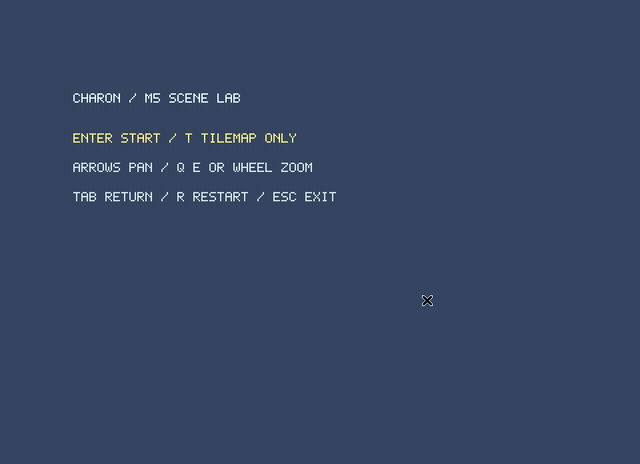
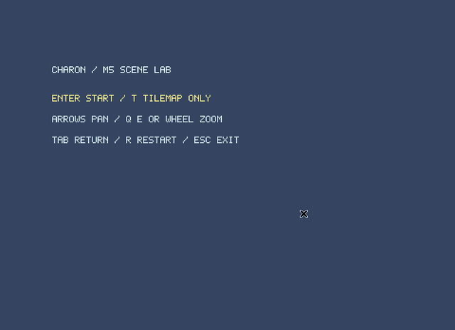

# M5 Scene Lab

Input Plugin、独立した2D Camera、Sceneの開始・再開始・終了を試すゲームサンプルです。SceneごとにAppとリソースを所有し、終了時にゲーム・計算workerをjoinして入力・アセット・GPUリソースを解放します。

Windows 11（Rust導入済み）でリポジトリのルートから実行します。

```powershell
# Tilemap + Falling Sand + Lighting
cargo run --release -p charon-m5-sample

# Falling Sandを依存に含めない構成
cargo run --release -p charon-m5-sample --no-default-features --features lighting

# LightingもFalling Sandも含めない構成
cargo run --release -p charon-m5-sample --no-default-features
```

## メニュー

Enterでゲームを開始し、TでTilemap単体のSceneを開始します。Escで終了します。`--tilemap-only` を指定するとEnterでもTilemap単体になります。

## ゲーム

| 操作 | 結果 |
| --- | --- |
| WASD | プレイヤーを移動して宝石を集める |
| 矢印キー | Cameraを移動する |
| Q / E、ホイール | ズームする。ポインターの下のworld座標を保つ |
| Space | world全体を表示する |
| 左 / 右クリック | Cameraの逆変換を使って掘る / 選択タイルを設置する |
| 1 / 2 / 3 | 石 / 砂ブロック / 水ブロックを選択する |
| B / G | 砂・水ブロックを壊す / 中央の通路を開閉する |
| F | 連携モードで火を生成する |
| T / O / V / K / L | 松明 / 発光鉱石 / AO / 空の光 / 照明合成を切り替える |
| Z | 照明の解像度を切り替える |
| R | Sceneを破棄し、新しいworld・Camera・照明・アセットで再開始する |
| Tab / Esc | Sceneを終了してメニューへ戻る |

Cameraを動かしたりズームしても、地形・Sprite・粒子・照明は同じ座標変換を使います。描画はviewport内へクリップし、UI上のクリックでは掘削しません。Sceneを切り替えた時に押していたボタンは、一度解放するまで次のSceneへ渡しません。

ゲーム更新144Hz、計算30〜60Hz、描画要求60Hz、照明提出30Hzです。指定周期は目標値です。計算周期を変更する例：

```powershell
cargo run --release -p charon-m5-sample -- --compute-hz 30
```

## 確認コマンド

```powershell
cargo run -p charon-m5-sample -- --smoke-test
cargo run -p charon-m5-sample -- --gpu-check
python scripts/check_m5_dependencies.py
```

smokeは入力からの掘削、再開始時のworld/Camera/照明設定の初期化、旧入力口の切断、アセット解放、worker停止、古いSceneIdの拒否を確認します。

`--gpu-check` は実ウィンドウとInputClientへのテスト入力を使い、リサイズ・pan・zoom・逆変換による掘削、CPU/GPUの照明比較、Scene再開始とメニュー復帰後のGPUリソース数を確認します。OSイベントを送る操作GIFとは別の検証です。

実操作GIFはLinux GitHub Actions / Xvfb上で、XTestのキー・マウス入力を使って録画します。Windows 11実機での表示・入力は未確認です。

[Input / Camera / Scene APIと所有権](../../docs/input-camera-scene-api.md)

## M5実装事例





[連携録画情報](../../docs/demos/m5-demo.json) / [Tilemap単体録画情報](../../docs/demos/m5-tilemap-demo.json)

Windows・macOS・LinuxのCIでテストとリリースビルドを確認し、Linuxでは上記3構成のネイティブGPU確認も実行しています。Windows 11実機での操作確認は未実施です。

## Windows 11実機での確認項目

- [ ] Enterで開始し、WASDで移動して宝石を取得できる。
- [ ] 矢印・Q/E・ホイールでCameraを動かしても、地形・粒子・照明の位置が一致する。
- [ ] ズーム後もクリックしたタイルを編集でき、ヘッダー・フッターのクリックでは掘削しない。
- [ ] Rで地形・Camera・照明設定が初期化され、Tabでメニューに戻る。
- [ ] 再開始・メニュー復帰を繰り返しても旧Sceneの入力や更新が残らない。
- [ ] フォーカスを外して戻った時にキーやマウスの押しっぱなしが残らない。
- [ ] 依存を除いた2つのコマンドでも、同じ入力・Camera・Scene操作を使える。
