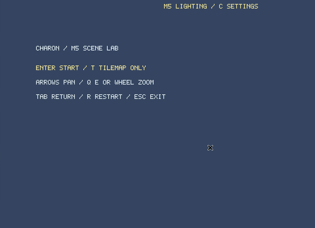
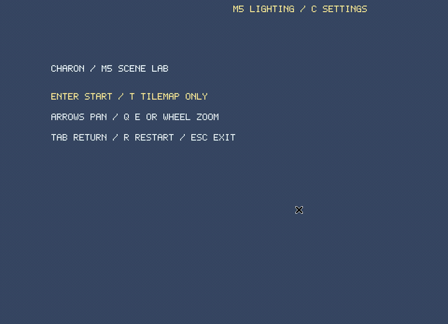

# Ray / Path Lighting Lab（M6.1）

設定画面とJSON設定はこのデモの機能です。Core／PluginはファイルやUIを持たず、デバイス能力の取得と明示的な切り替えAPIを公開します。

Windows 11（Rust導入済み）でリポジトリのルートから起動します。

```powershell
# PC：PathとM5照明を試す
cargo run --release -p charon-rt-sample

# PC：RTX実機で確認する
cargo run --release -p charon-rt-sample -- --config samples/rt-light-lab/config/rtx.json

# Mobile Liteのデスクトッププレビュー。RTXとFalling Sandを依存から除く
cargo run --release -p charon-rt-sample --no-default-features -- --mobile

# Mobile LiteでもFalling Sandを組み合わせる
cargo run --release -p charon-rt-sample --no-default-features --features bridge -- --mobile
```

Enterで開始し、Cでデモ用の設定画面を開きます。1〜4かクリックで方式を選び、Cで閉じます。灰色の方式は理由を表示して選択を拒否します。設定変更時に非対応ならAPIはfalseを返し、現在の方式を維持します。Shaderの初期化などが失敗しても現在の方式を維持し、デモにエラーを表示します。

WASDで移動、矢印でCamera移動、Q/E・ホイールでズーム、左クリックでタイル破壊、右クリックで設置、Bで砂・水ブロックを解放、Fで火の粒子を生成します。Tは持っている光源、Oは発光鉱石、Gは通路、Rは再開始、Tabはメニューです。照明の遮光・透過・発光にはタイルも粒子も含みます。

## デモの設定ファイル

```powershell
cargo run --release -p charon-rt-sample -- --config samples/rt-light-lab/config/pc.json
cargo run --release -p charon-rt-sample --no-default-features -- --config samples/rt-light-lab/config/mobile.json
```

```json
{"mobile":false,"lighting":"path","update_hz":30}
```

`lighting` は `rtx / path / lite_path / m5` です。MobileではLite/M5だけを許可するのは、このデモの選択ルールです。設定画面のSで、`--config` で指定したファイルに保存します。未指定の場合はファイルを書きません。不正なファイルは読込エラーにします。非対応・初期化失敗の要求は未適用として理由を表示し、デモ側のルールでM5照明を維持します。`--gpu-check` では要求した方式が実適用されなければ成功終了しません。

`config.rs` がファイル形式と選択ルール、`settings.rs` がUIと描画との接続を担当します。どちらもプラグインの外です。

## RTX実機での確認（ユーザー担当）

```powershell
# RTXが実行できるGPUを必要とする数値比較
cargo run --release -p charon-tracing-check -- --rtx

# RTXモードのネイティブGPU確認
cargo run --release -p charon-rt-sample -- --lighting rtx --gpu-check
```

- [ ] RTXを選択できる。非対応のdeviceではfalseになり、Path/M5の状態が保持される。
- [ ] タイルの壁で遮光し、Gで通路を開閉すると反映される。
- [ ] Bで砂・水に変換し、粒子の堆積・流れで照明が変化する。
- [ ] 水が光を透過し、火・鉱石が発光する。
- [ ] 動く光源や地形編集の後に、古い光・影が残らない。
- [ ] RTX／Path／M5を切り替えられ、Camera・ズーム後も照明が一致する。
- [ ] R・Tabを繰り返してSceneとGPU資源を解放できる。

RTXの実機実行は開発環境では未検証です。通常CIで確認するのはPath/Liteの実行と、RTXのコンパイル・Shader静的検証までです。MobileプレビューはAndroid/iOS実機での動作保証を示しません。

[API・制約・責務の分離](../../docs/tracing-api.md)

## RTX対応PCで「再起動が必要」を確認する

```powershell
cargo run --release -p charon-rt-sample -- --config samples/rt-light-lab/config/pc-rt-disabled.json
```

このデモ設定だけは、対応GPUでもRT機能をdevice作成時に有効にしません。C→1で要求すると、現在の方式を維持したまま再起動待ち・falseになります。Sで `pending: "rtx"` とdevice生成要求を保存し、デモを終了して同じコマンドを実行してください。新device上で実際のRay Queryと最初の照明計算が通った時だけRTXを適用します。ログの `LIGHTING DEVICE` と `LIGHTING SWITCH` で状態を確認できます。

- [ ] 再起動前はfalse・未適用で、旧方式が維持される。
- [ ] 保存先のpending要求と、現在適用されたlightingが区別される。
- [ ] 再起動後、probeと照明計算が成功した時だけtrue・RTX適用になる。
- [ ] ドライバーやdeviceの生成条件で失敗した場合は、再起動後もtrueと表示しない。

ハードウェア非対応は再起動待ちとは表示せず、選択不可のままにします。

## 光源移動とCPU構成

PCの照明は専用ワーカーで最大144Hz、ゲーム144Hz・描画60Hz・物理30〜60Hzとは別に実行します。直接光を決定的に計算し、間接光だけを蓄積・平滑化します。CPU数に合わせた共有ジョブプールを使い、8論理CPUなら物理3・照明3、4論理CPUなら各1の予算になります。独立しない物理領域は更新順を保って逐次計算します。詳細は [Tracing API](../../docs/tracing-api.md#動く光源と計算スレッド) を参照してください。

4 CPU相当の追加ワーカーなし構成：

```powershell
cargo run --release -p charon-rt-sample -- --cpu-budget 4
```

## 操作記録





[PC Path録画情報](../../docs/demos/m6-rt-demo.json) / [Liteプレビュー録画情報](../../docs/demos/m6-rt-mobile-demo.json)

Linux / Xvfb上の実ウィンドウへキー入力を送り、設定画面の未対応項目、方式の切り替え、砂・水ブロックの解放、火の発光、光源の移動・削除、Scene再開始を録画しています。RTXの実行映像やMobile実機の映像ではありません。
